# ผังความปลอดภัยและการรักษาข้อมูลของ MealQ

เอกสารชุดนี้อธิบายว่า **ข้อมูลถูกส่ง ตรวจสอบ จำกัดสิทธิ์ จัดเก็บ และกู้คืนอย่างไรตามโค้ดปัจจุบัน** โดยแบ่งเป็น 14 ผัง ใช้อ่านประกอบรายงานหรืออธิบายโครงงานให้อาจารย์ และมีไฟล์ต้นฉบับแก้ไขต่อได้

[เปิด PDF รวม 14 ผัง](MealQ-Security-Workflows.pdf) มี bookmarks สำหรับเลือกเรื่องในตัว PDF

ตรวจจาก source วันที่ **20 ตุลาคม 2569** ฐานโค้ด HEAD `8d728afd125d27f4beccc506bdd3bd0dafe02662` เป็นการอ่านโค้ดและไฟล์ตั้งค่า ไม่ใช่ penetration test ไม่ได้อ่าน secret จริง และไม่ได้ตรวจสถานะ production, firewall, DNS/TLS, schedule หรือผล backup/restore ล่าสุด ลิงก์ source ระบุ commit เพื่ออ้างอิงเวอร์ชันที่ตรวจ

## อ่านผังอย่างไร

- เริ่มหน้า 01 เพื่อดูแนวป้องกันตลอดทาง แล้วอ่าน 02-07 เรื่องบัญชีและตัวตน
- หน้า 08-10 อธิบายความถูกต้องของออเดอร์ เงิน สต็อก และความเป็นส่วนตัวของแจ้งเตือน
- หน้า 11-13 อธิบาย Browser ข้อมูลสาธารณะ การเก็บ secret และการสำรอง
- หน้า 14 แสดง **ข้อเสนอที่ยังไม่ได้เพิ่ม** แยกจากกลไกที่มีอยู่แล้ว
- กล่องคือกิจกรรม ข้าวหลามตัดคือเงื่อนไข ลูกศรคือลำดับ เส้นประคือการเชื่อมโยง กล่องสีแดงต้องอ่านข้อจำกัดหรือการปฏิเสธที่กำกับ ไม่ตีความจากสีอย่างเดียว

## คำที่ต้องแยกให้ออก

| กลไก | ใช้กับอะไรใน MealQ | ป้องกันอะไร | ไม่ได้หมายความว่า |
|---|---|---|---|
| HTTPS/Tunnel encryption | การส่ง Browser → Cloudflare → connector | ลดการดักอ่านระหว่างทางที่เข้ารหัส | ทุก hop และฐานข้อมูลเข้ารหัสทั้งหมด |
| scrypt + salt สุ่ม | password_hash | ไม่เก็บรหัสผ่านตรง ๆ และเพิ่มต้นทุนการเดารหัสจาก hash | ถอดรหัสกลับได้ หรือรหัสอ่อนไม่ถูกเดาได้ |
| HMAC-SHA256 | session, OAuth state และ OTP digest | ตรวจค่าที่ผูกกับ secret; session/state ที่ถูกแก้ไม่ผ่านลายเซ็น | payload session เป็นความลับ หรือ token ที่ขโมยไปใช้ไม่ได้ |
| SHA-256 ของ token สุ่ม | reset_token_hash | DB ไม่ต้องเก็บ reset token จริง | ใช้ SHA-256 เปล่าแทน scrypt กับรหัสผ่านผู้ใช้ |
| HttpOnly / Secure | session cookie | ลดการอ่าน cookie ผ่าน JS / ส่ง cookie ผ่าน HTTPS | ป้องกัน XSS หรือ CSRF ทุกกรณี |
| RBAC + ownership query | API ส่วนตัว | จำกัดบทบาทและเจ้าของ record ฝั่งเซิร์ฟเวอร์ | ซ่อนปุ่มแล้วเพียงพอ หรือ admin ทุก endpoint เลือกร้านใดก็ได้ |
| Conditional atomic update + marker | สต็อก Wallet coupon และสถานะออเดอร์ | กันการแก้ชน/ซ้ำในจุดที่ตรวจเงื่อนไข | มี transaction เดียวครอบทุก collection |
| Backup + checksum | สำเนาฐานข้อมูลและ config | ตรวจความคงเดิมของไฟล์และช่วยกู้คืน | ไฟล์ gzip เข้ารหัส หรือ restore ผ่านล่าสุดแล้ว |

## ใครเข้าถึงข้อมูลใด

| ผู้ใช้งาน | ขอบเขตที่ตรวจบน Backend | ข้อมูลที่ตั้งใจให้เห็น |
|---|---|---|
| ผู้เยี่ยมชม | public catalogue/media/review | เมนู รูป ข้อมูลติดต่อและพิกัดร้าน ชื่อผู้รีวิว; บาง operational fields ยังควรลดการเปิดเผย |
| ลูกค้า | requireAuth + customer และ customer_id | โปรไฟล์ คูปอง Wallet แจ้งเตือน และออเดอร์ของตน |
| เจ้าของร้าน | role merchant + ร้านจาก owner_id | เมนู วัตถุดิบ ออเดอร์ร้าน รวมชื่อลูกค้า อีเมล และรหัสรับอาหาร |
| พนักงาน | role staff + store_id ที่ได้รับมอบหมาย | งานร้านในขอบเขตร้าน; ปัจจุบันไม่ได้แยกสิทธิ์ราย operation; inbox/push ร้านยังจำกัด role merchant |
| แอดมิน | role admin + first-password-change gate | งานบริหารผ่าน admin routes พร้อม audit สำหรับการเปลี่ยนข้อมูล; ไม่ใช่สิทธิ์ข้าม scope ใน merchant controller โดยอัตโนมัติ |

## ข้อมูลสำคัญและอายุ

| ข้อมูล | รูปแบบที่เก็บ / ที่อยู่ | อายุหรือการยกเลิก |
|---|---|---|
| รหัสผ่าน | scrypt$salt$hash ใน MongoDB | จนเปลี่ยนรหัส; ไม่ส่ง hash ใน userView |
| OTP สมัคร / เปลี่ยนอีเมล | HMAC ผูก ticket และ metadata | 10 นาที, 5 attempts, resend 60 วินาที; draft TTL 24 ชั่วโมงเป็นการทำความสะอาด |
| Reset token | SHA-256 hash ใน User; token จริงอยู่ลิงก์เมล | 15 นาที, ใช้แล้วล้าง; production ไม่คืน token ใน API |
| Session | signed cookie มี sub/exp/ver ที่อ่านได้ | rememberMe 30 วัน; ไม่เลือก token 24 ชั่วโมงและ session cookie; HTTP ตรวจ version ทุกครั้ง |
| OAuth state | signed payload + nonce cookie | 10 นาที, ตรวจ callback และล้าง nonce cookie |
| ชื่อ อีเมล โทรศัพท์ ออเดอร์ และ Wallet | ข้อมูลปกติใน MongoDB | ยังไม่พบ retention/deletion policy ครอบคลุม; ไม่พบ field encryption |
| Push endpoint/keys และ VAPID private key | MongoDB; private key ไม่เลือกคืนตามปกติ | เลิกสมัครหรือปิด endpoint ที่ provider ตอบ 404/410; ต้องจำกัดสิทธิ์ DB |
| Browser storage | cart/favorites/preferences/notification summaries และ challenge/retry metadata | เป็นข้อมูลค้างบนเครื่อง ไม่ควรใช้เครื่องร่วมโดยไม่ดูแล; ไม่พบ password/auth token ใน localStorage |
| Backup บน Pi / สำเนา Windows | Pi plaintext owner-only; Windows AES + HMAC + DPAPI | สคริปต์ไม่ลบ snapshot เก่าอัตโนมัติ; ยังไม่ยืนยัน schedule/ผล restore จริง |

## ข้อควรเสริมที่พบจาก source

1. จำกัดการลอง login/forgot/reset และ pickup code รวมทั้งการเฝ้าระวัง abuse
2. เพิ่ม CSRF defense สำหรับ mutation ที่ใช้ cookie; HTTPS session เป็น SameSite=None และ CORS ไม่ใช่ CSRF defense ที่ครบ
3. ทำ session revocation ตอน logout และตรวจอายุ/การยกเลิก realtime ต่อเนื่อง; resetPassword ยังไม่ disconnect Socket.IO ทันที
4. เพิ่ม re-auth/MFA ตามความเสี่ยง; ปัจจุบัน OTP เป็นยืนยันสมัคร/เปลี่ยนอีเมล ไม่ใช่ MFA ทุกครั้งที่ login และ email change ไม่ถาม current password
5. ทบทวน public fields, server-side image byte validation, external image policy, CSV formula neutralization และ CSP/security headers
6. ตรวจ MongoDB authentication/TLS การแยก network สิทธิ์ไฟล์ลับ disk/backup encryption การหมุน key และ restore drill บน runtime จริง

ไม่มีการแก้โค้ดแอปหรือเปลี่ยนการตั้งค่าระบบจากงานเอกสารนี้ การเพิ่มมาตรการข้างต้นต้องออกแบบและทดสอบแยกต่างหาก

## รายการผัง

| ผัง | เนื้อหา | ไฟล์ |
|---|---|---|
| 01 | ข้อมูลเดินทางผ่านแนวป้องกันใดบ้าง | [PNG](png/01-data-journey.png) · [SVG](svg/01-data-journey.svg) · [Mermaid](mermaid/01-data-journey.mmd) |
| 02 | สมัครบัญชี: ยืนยันอีเมลก่อนสร้างผู้ใช้ | [PNG](png/02-registration-otp.png) · [SVG](svg/02-registration-otp.svg) · [Mermaid](mermaid/02-registration-otp.mmd) |
| 03 | เข้าสู่ระบบ: ตรวจ password hash แล้วออก cookie | [PNG](png/03-login-session.png) · [SVG](svg/03-login-session.svg) · [Mermaid](mermaid/03-login-session.mmd) |
| 04 | ทุก API ส่วนตัว: ตรวจตัวตน บทบาท และเจ้าของข้อมูล | [PNG](png/04-auth-role-ownership.png) · [SVG](svg/04-auth-role-ownership.svg) · [Mermaid](mermaid/04-auth-role-ownership.mmd) |
| 05 | Google Login: ไม่ส่งรหัสผ่าน Google ให้ MealQ | [PNG](png/05-google-oauth.png) · [SVG](svg/05-google-oauth.svg) · [Mermaid](mermaid/05-google-oauth.mmd) |
| 06 | ลืมและเปลี่ยนรหัสผ่าน: token ใช้ครั้งเดียวและยกเลิก session เก่า | [PNG](png/06-password-recovery.png) · [SVG](svg/06-password-recovery.svg) · [Mermaid](mermaid/06-password-recovery.mmd) |
| 07 | เปลี่ยนอีเมล: ใช้ session ปัจจุบันและ OTP ของอีเมลใหม่ | [PNG](png/07-email-change.png) · [SVG](svg/07-email-change.svg) · [Mermaid](mermaid/07-email-change.mmd) |
| 08 | สั่งซื้อ: เซิร์ฟเวอร์เป็นผู้ตัดสินราคา สต็อก และยอดเงิน | [PNG](png/08-checkout-integrity.png) · [SVG](svg/08-checkout-integrity.svg) · [Mermaid](mermaid/08-checkout-integrity.mmd) |
| 09 | รับอาหาร ยกเลิก และกู้คืนงานที่ทำไม่ครบ | [PNG](png/09-fulfillment-recovery.png) · [SVG](svg/09-fulfillment-recovery.svg) · [Mermaid](mermaid/09-fulfillment-recovery.mmd) |
| 10 | แจ้งเตือน: ส่งให้บัญชีและอุปกรณ์ที่ถูกคน | [PNG](png/10-notification-privacy.png) · [SVG](svg/10-notification-privacy.svg) · [Mermaid](mermaid/10-notification-privacy.mmd) |
| 11 | Browser รูปภาพ และข้อมูลที่เปิดเผยต่อสาธารณะ | [PNG](png/11-browser-public-media.png) · [SVG](svg/11-browser-public-media.svg) · [Mermaid](mermaid/11-browser-public-media.mmd) |
| 12 | เก็บข้อมูลอะไร และส่วนใดเป็นความลับ | [PNG](png/12-data-storage-secrets.png) · [SVG](svg/12-data-storage-secrets.svg) · [Mermaid](mermaid/12-data-storage-secrets.mmd) |
| 13 | สำรองและกู้คืน: รักษาทั้งความลับและความพร้อมใช้ | [PNG](png/13-backup-and-restore.png) · [SVG](svg/13-backup-and-restore.svg) · [Mermaid](mermaid/13-backup-and-restore.mmd) |
| 14 | สิ่งที่ยังควรเสริมก่อนยกระดับใช้งานจริง | [PNG](png/14-gaps-and-next-controls.png) · [SVG](svg/14-gaps-and-next-controls.svg) · [Mermaid](mermaid/14-gaps-and-next-controls.mmd) |

## 01 ข้อมูลเดินทางผ่านแนวป้องกันใดบ้าง

อ่านจากซ้ายไปขวา: การเข้ารหัสระหว่างส่ง การตรวจคำขอ และการเก็บข้อมูลเป็นคนละชั้นของการป้องกัน

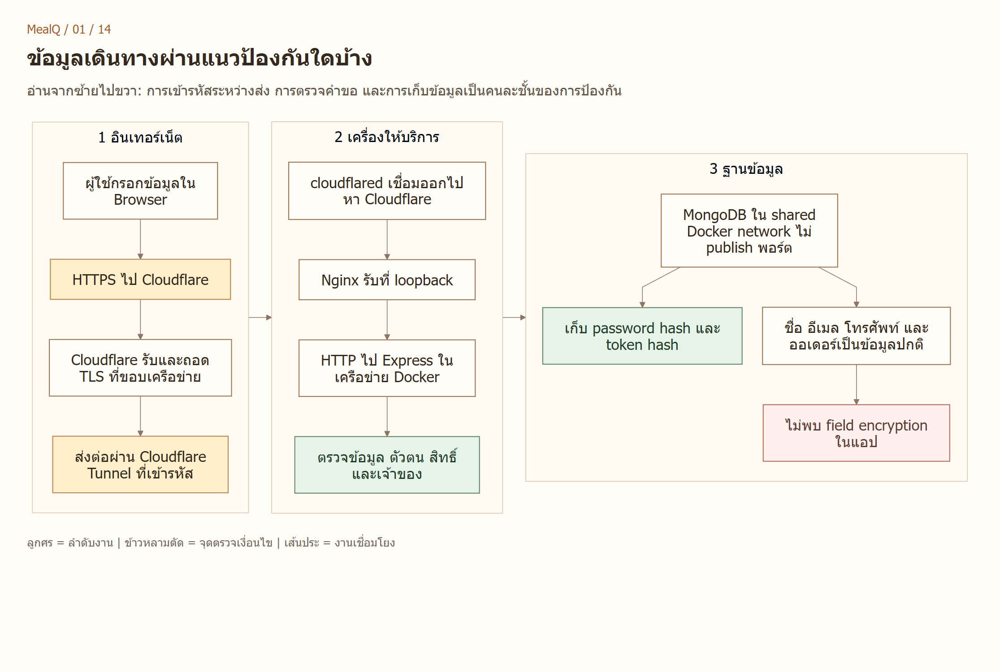

**ข้อมูลและกลไก:** ข้อมูลที่ส่ง: ข้อมูลบัญชีและออเดอร์ผ่าน HTTPS | ข้อมูลที่เก็บ: hash สำหรับรหัสลับ แต่ PII ยังเป็นค่าปกติ

1. HTTPS ป้องกันการดักอ่านระหว่าง Browser กับ Cloudflare; Cloudflare เป็นจุดจบ TLS และจึงประมวลผลคำขอได้ จากนั้นใช้ Tunnel ที่เข้ารหัสถึง cloudflared
2. ตาม production compose: เว็บผูกกับ loopback ส่วน API และ MongoDB ไม่ publish พอร์ต แต่ใช้ shared Docker network ไม่ได้แยกจากทุก container การส่งต่อ Nginx → API เป็น HTTP ภายใน
3. ไม่พบ field-level encryption ของข้อมูลส่วนตัว หรือ TLS ของการเชื่อม MongoDB ในค่าตั้งต้น และยังไม่ได้ตรวจการเข้ารหัสดิสก์หรือสถานะเครื่องจริง
4. CORS ตรวจ Origin ของ Browser ตาม allowlist; clients ที่ไม่มี Origin ยังเข้า API ได้และต้องผ่านการตรวจตัวตน/สิทธิ์เช่นเดิม

โค้ดอ้างอิง: [backend/src/server.js](https://github.com/MiniProject-Web-MealQ/food-ordering-platform-mongodb/blob/8d728afd125d27f4beccc506bdd3bd0dafe02662/backend/src/server.js), [backend/src/config/cors.js](https://github.com/MiniProject-Web-MealQ/food-ordering-platform-mongodb/blob/8d728afd125d27f4beccc506bdd3bd0dafe02662/backend/src/config/cors.js), [backend/src/config/db.js](https://github.com/MiniProject-Web-MealQ/food-ordering-platform-mongodb/blob/8d728afd125d27f4beccc506bdd3bd0dafe02662/backend/src/config/db.js), [deploy/compose.yaml](https://github.com/MiniProject-Web-MealQ/food-ordering-platform-mongodb/blob/8d728afd125d27f4beccc506bdd3bd0dafe02662/deploy/compose.yaml), [deploy/nginx.conf](https://github.com/MiniProject-Web-MealQ/food-ordering-platform-mongodb/blob/8d728afd125d27f4beccc506bdd3bd0dafe02662/deploy/nginx.conf), [deploy/tunnel.compose.yaml](https://github.com/MiniProject-Web-MealQ/food-ordering-platform-mongodb/blob/8d728afd125d27f4beccc506bdd3bd0dafe02662/deploy/tunnel.compose.yaml)

Mermaid สำหรับแก้ไขผัง

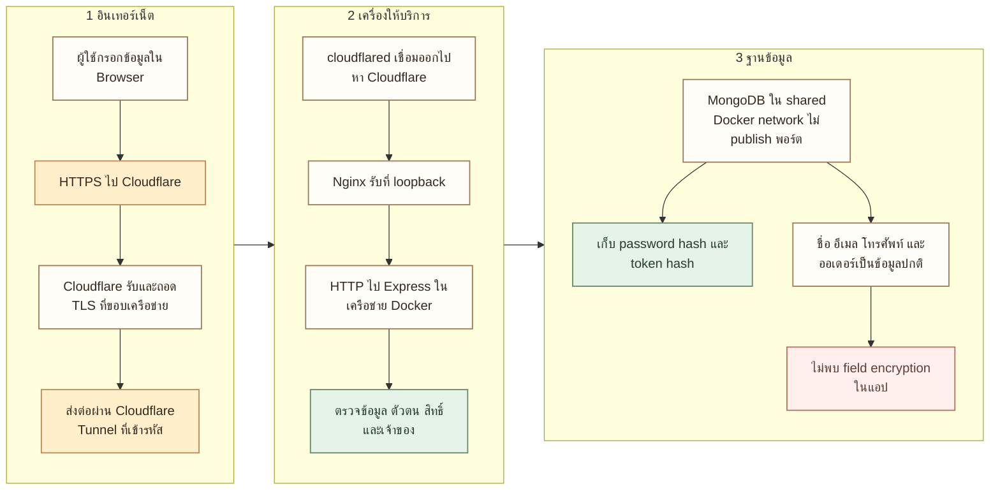

## 02 สมัครบัญชี: ยืนยันอีเมลก่อนสร้างผู้ใช้

รหัสผ่านถูกแฮชก่อนเก็บ draft; OTP จริงส่งทางอีเมลและมีอายุจำกัด

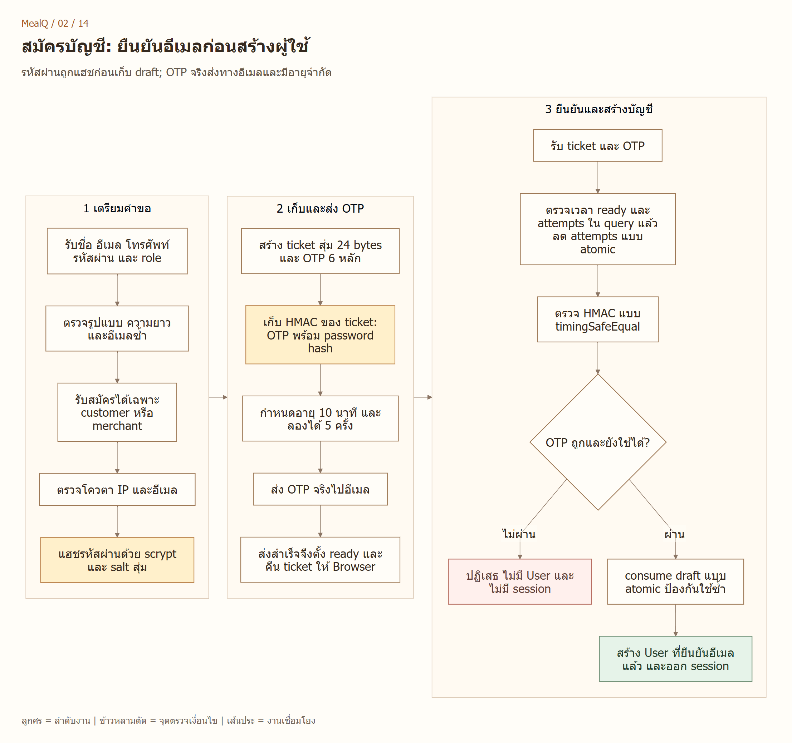

**ข้อมูลและกลไก:** รหัสผ่าน: scrypt hash | OTP: HMAC-SHA256 | ticket: สุ่ม 24 bytes | OTP หมดอายุ: 10 นาที

1. รหัสผ่าน 8-128 ตัว ต้องมีตัวอักษรและตัวเลข; self-registration สร้าง admin หรือ staff ไม่ได้ ร้านใหม่อยู่สถานะ pending และปิดรับออเดอร์
2. ส่ง OTP ได้ 5 ครั้ง/อีเมล/ชั่วโมง และ 20 ครั้ง/IP/ชั่วโมง; verify ได้ 100 ครั้ง/IP/ชั่วโมง; ส่งซ้ำรอ 60 วินาทีและทำให้ OTP เก่าใช้ไม่ได้
3. PendingRegistration เก็บ password_hash, otp_hash, ticket และข้อมูล draft; ไม่เก็บรหัสผ่านหรือ OTP ตรง ๆ การเทียบ HMAC ใช้ timingSafeEqual
4. TTL ลบ draft หลัง 24 ชั่วโมงเป็นงานทำความสะอาด ส่วนอายุ OTP 10 นาทีตรวจใน query จึงไม่ต้องรอ TTL worker; Frontend เก็บเฉพาะ challenge metadata ใน sessionStorage

โค้ดอ้างอิง: [backend/src/controllers/authController.js](https://github.com/MiniProject-Web-MealQ/food-ordering-platform-mongodb/blob/8d728afd125d27f4beccc506bdd3bd0dafe02662/backend/src/controllers/authController.js), [backend/src/services/registration-otp.js](https://github.com/MiniProject-Web-MealQ/food-ordering-platform-mongodb/blob/8d728afd125d27f4beccc506bdd3bd0dafe02662/backend/src/services/registration-otp.js), [backend/src/services/auth-validation.js](https://github.com/MiniProject-Web-MealQ/food-ordering-platform-mongodb/blob/8d728afd125d27f4beccc506bdd3bd0dafe02662/backend/src/services/auth-validation.js), [backend/src/services/password.js](https://github.com/MiniProject-Web-MealQ/food-ordering-platform-mongodb/blob/8d728afd125d27f4beccc506bdd3bd0dafe02662/backend/src/services/password.js), [backend/src/models/PendingRegistration.js](https://github.com/MiniProject-Web-MealQ/food-ordering-platform-mongodb/blob/8d728afd125d27f4beccc506bdd3bd0dafe02662/backend/src/models/PendingRegistration.js), [backend/src/models/AuthRateLimit.js](https://github.com/MiniProject-Web-MealQ/food-ordering-platform-mongodb/blob/8d728afd125d27f4beccc506bdd3bd0dafe02662/backend/src/models/AuthRateLimit.js), [frontend/src/features/auth/registration-challenge.js](https://github.com/MiniProject-Web-MealQ/food-ordering-platform-mongodb/blob/8d728afd125d27f4beccc506bdd3bd0dafe02662/frontend/src/features/auth/registration-challenge.js)

Mermaid สำหรับแก้ไขผัง

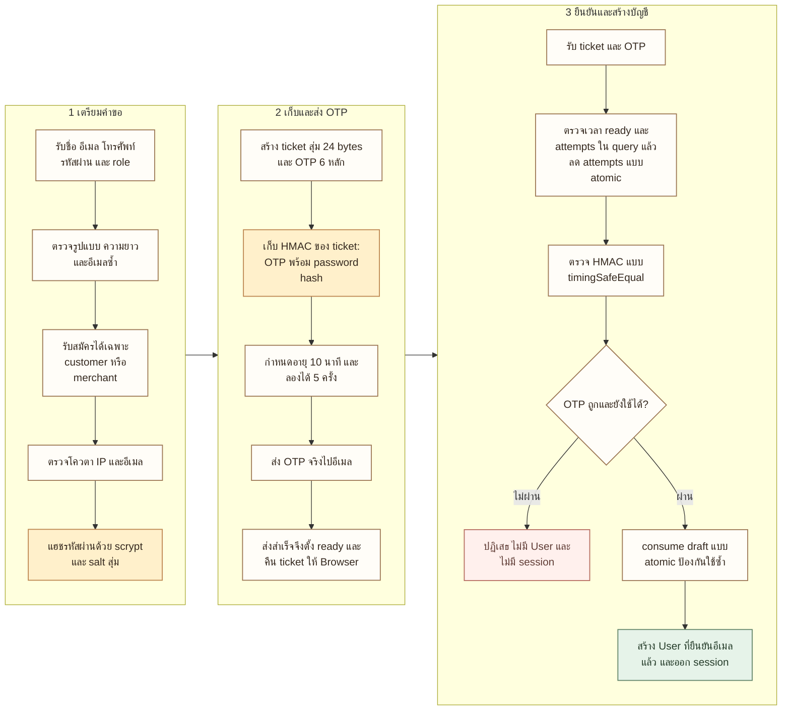

## 03 เข้าสู่ระบบ: ตรวจ password hash แล้วออก cookie

แฮชรหัสผ่านช่วยลดความเสียหายเมื่อฐานข้อมูลรั่ว ส่วนลายเซ็น session ช่วยตรวจว่าข้อมูลถูกแก้ไขหรือไม่

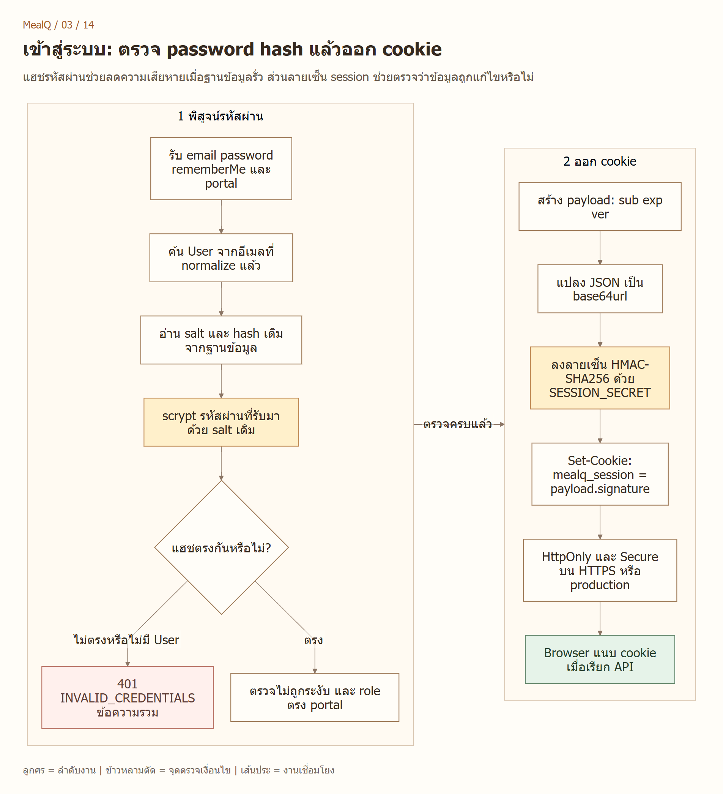

**ข้อมูลและกลไก:** ไม่คืน password_hash/reset_token_hash ผ่าน userView | ไม่เก็บ session token ใน localStorage | cookie เป็น bearer credential

1. ตอนสร้างรหัสผ่านใช้ salt สุ่มใหม่ 16 bytes และ scrypt ได้ derived key 64 bytes เก็บเป็น scrypt$salt$hash; การตรวจใช้ timingSafeEqual แทนการเทียบข้อความทั่วไป
2. Session เป็น custom signed token ไม่ใช่ JWT: payload มี user ID, เวลาหมดอายุ และ session_version เท่านั้น base64url อ่านกลับได้ ลายเซ็นไม่ได้เข้ารหัสข้อมูลให้เป็นความลับ
3. จำฉันไว้: token และ cookie อยู่ 30 วัน; ไม่เลือก: token อยู่ 24 ชั่วโมง แต่ cookie ไม่มี maxAge เป็น browser-session cookie ค่า SameSite เป็น None บน HTTPS และ Lax กรณีอื่น
4. HttpOnly ลดการอ่าน cookie ผ่าน JavaScript แต่ไม่กัน XSS ทุกผลกระทบ; ไม่พบ rate limit สำหรับ local login และ logout ลบ cookie เครื่องนั้นโดยไม่ revoke สำเนา token

โค้ดอ้างอิง: [backend/src/controllers/authController.js](https://github.com/MiniProject-Web-MealQ/food-ordering-platform-mongodb/blob/8d728afd125d27f4beccc506bdd3bd0dafe02662/backend/src/controllers/authController.js), [backend/src/services/password.js](https://github.com/MiniProject-Web-MealQ/food-ordering-platform-mongodb/blob/8d728afd125d27f4beccc506bdd3bd0dafe02662/backend/src/services/password.js), [backend/src/services/session.js](https://github.com/MiniProject-Web-MealQ/food-ordering-platform-mongodb/blob/8d728afd125d27f4beccc506bdd3bd0dafe02662/backend/src/services/session.js), [backend/src/services/user-view.js](https://github.com/MiniProject-Web-MealQ/food-ordering-platform-mongodb/blob/8d728afd125d27f4beccc506bdd3bd0dafe02662/backend/src/services/user-view.js), [frontend/src/lib/api-client.js](https://github.com/MiniProject-Web-MealQ/food-ordering-platform-mongodb/blob/8d728afd125d27f4beccc506bdd3bd0dafe02662/frontend/src/lib/api-client.js)

Mermaid สำหรับแก้ไขผัง

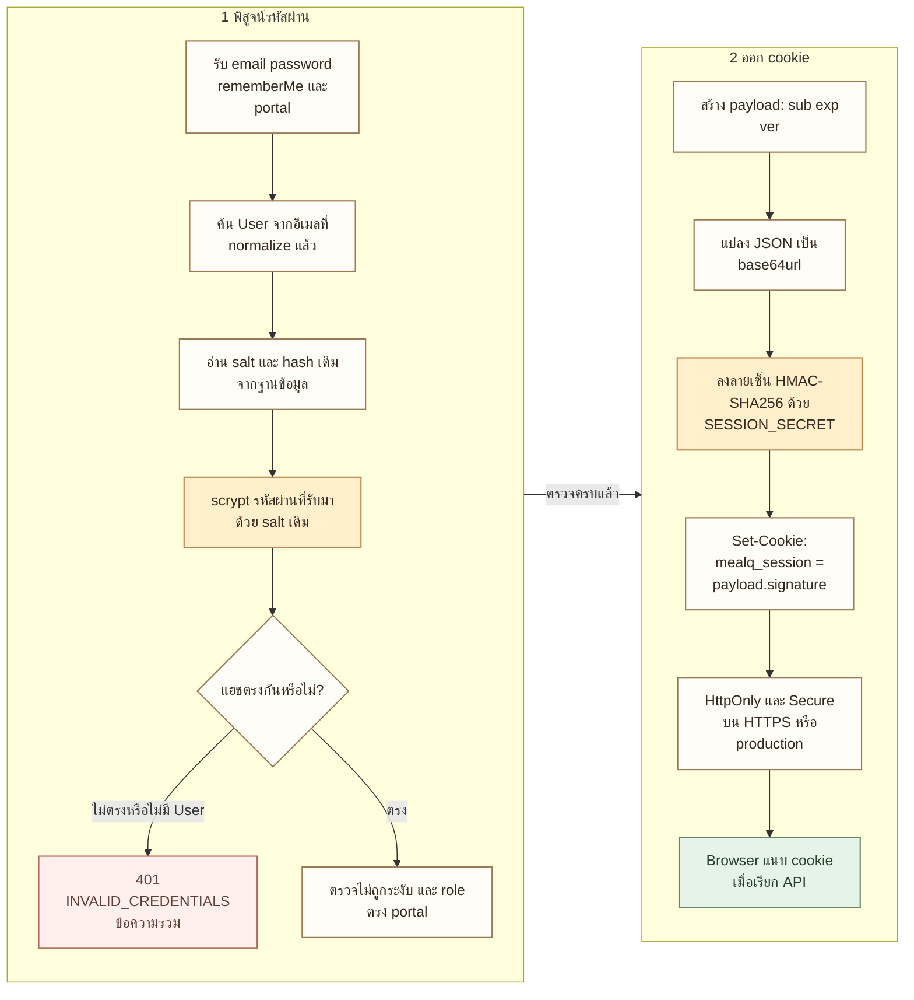

## 04 ทุก API ส่วนตัว: ตรวจตัวตน บทบาท และเจ้าของข้อมูล

การรู้ ID ของออเดอร์หรือร้านไม่เพียงพอ Controller ต้องกรองข้อมูลตามบัญชีที่เซิร์ฟเวอร์ตรวจแล้ว

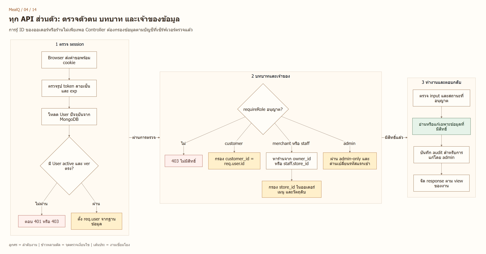

**ข้อมูลและกลไก:** HTTP 401 = ยังยืนยันตัวตนไม่ได้ | 403 = บัญชีหรือบทบาทไม่อนุญาต | ID จาก URL ต้องผ่าน ownership filter

1. requireAuth ตรวจ session_version กับ User ทุก protected HTTP request จึงตัดสิทธิ์ token เก่าได้หลังเปลี่ยนรหัส อีเมล บทบาท หรือระงับบัญชี; role อ้างอิง DB ไม่เชื่อ role ที่ Browser ส่ง
2. customer ดู/ยกเลิก/รีวิวเฉพาะออเดอร์ตนเอง; merchant ใช้ร้านที่ตนเป็นเจ้าของ; staff ใช้ store_id ที่บัญชีได้รับมอบหมาย โดย staff มีสิทธิ์ปฏิบัติงานร้าน ไม่ใช่สิทธิ์อ่านอย่างเดียว
3. admin routes ใช้ role admin และบัญชีที่ must_change_password ต้องเปลี่ยนรหัสก่อนงานสำคัญ; การปรับสิทธิ์ ระงับ และการจัดการโดย admin มี AdminActivity
4. การกรองเจ้าของเกิดในแต่ละ controller ไม่ใช่แค่ซ่อนเมนูหน้าเว็บ และไม่ใช่ MongoDB row-level policy; ต้องตรวจ endpoint ใหม่ทุกครั้งที่เพิ่มฟังก์ชัน

โค้ดอ้างอิง: [backend/src/middleware/auth.js](https://github.com/MiniProject-Web-MealQ/food-ordering-platform-mongodb/blob/8d728afd125d27f4beccc506bdd3bd0dafe02662/backend/src/middleware/auth.js), [backend/src/routes/customerRoutes.js](https://github.com/MiniProject-Web-MealQ/food-ordering-platform-mongodb/blob/8d728afd125d27f4beccc506bdd3bd0dafe02662/backend/src/routes/customerRoutes.js), [backend/src/routes/orderRoutes.js](https://github.com/MiniProject-Web-MealQ/food-ordering-platform-mongodb/blob/8d728afd125d27f4beccc506bdd3bd0dafe02662/backend/src/routes/orderRoutes.js), [backend/src/routes/merchantRoutes.js](https://github.com/MiniProject-Web-MealQ/food-ordering-platform-mongodb/blob/8d728afd125d27f4beccc506bdd3bd0dafe02662/backend/src/routes/merchantRoutes.js), [backend/src/routes/adminRoutes.js](https://github.com/MiniProject-Web-MealQ/food-ordering-platform-mongodb/blob/8d728afd125d27f4beccc506bdd3bd0dafe02662/backend/src/routes/adminRoutes.js), [backend/src/services/merchant-store.js](https://github.com/MiniProject-Web-MealQ/food-ordering-platform-mongodb/blob/8d728afd125d27f4beccc506bdd3bd0dafe02662/backend/src/services/merchant-store.js), [backend/src/controllers/orderController.js](https://github.com/MiniProject-Web-MealQ/food-ordering-platform-mongodb/blob/8d728afd125d27f4beccc506bdd3bd0dafe02662/backend/src/controllers/orderController.js), [backend/src/controllers/merchantController.js](https://github.com/MiniProject-Web-MealQ/food-ordering-platform-mongodb/blob/8d728afd125d27f4beccc506bdd3bd0dafe02662/backend/src/controllers/merchantController.js), [backend/src/controllers/adminController.js](https://github.com/MiniProject-Web-MealQ/food-ordering-platform-mongodb/blob/8d728afd125d27f4beccc506bdd3bd0dafe02662/backend/src/controllers/adminController.js)

Mermaid สำหรับแก้ไขผัง

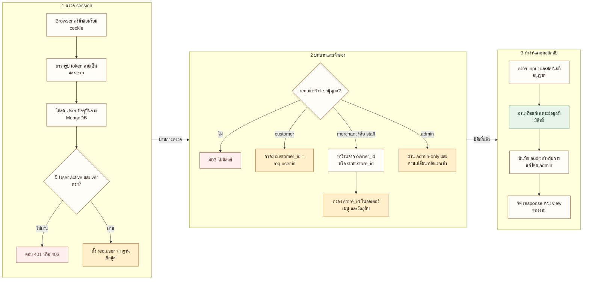

## 05 Google Login: ไม่ส่งรหัสผ่าน Google ให้ MealQ

state ที่ลงลายเซ็นและ nonce cookie ผูก callback กับ Browser ที่เริ่มคำขอ เพื่อลดการสวม callback ข้ามคำขอ

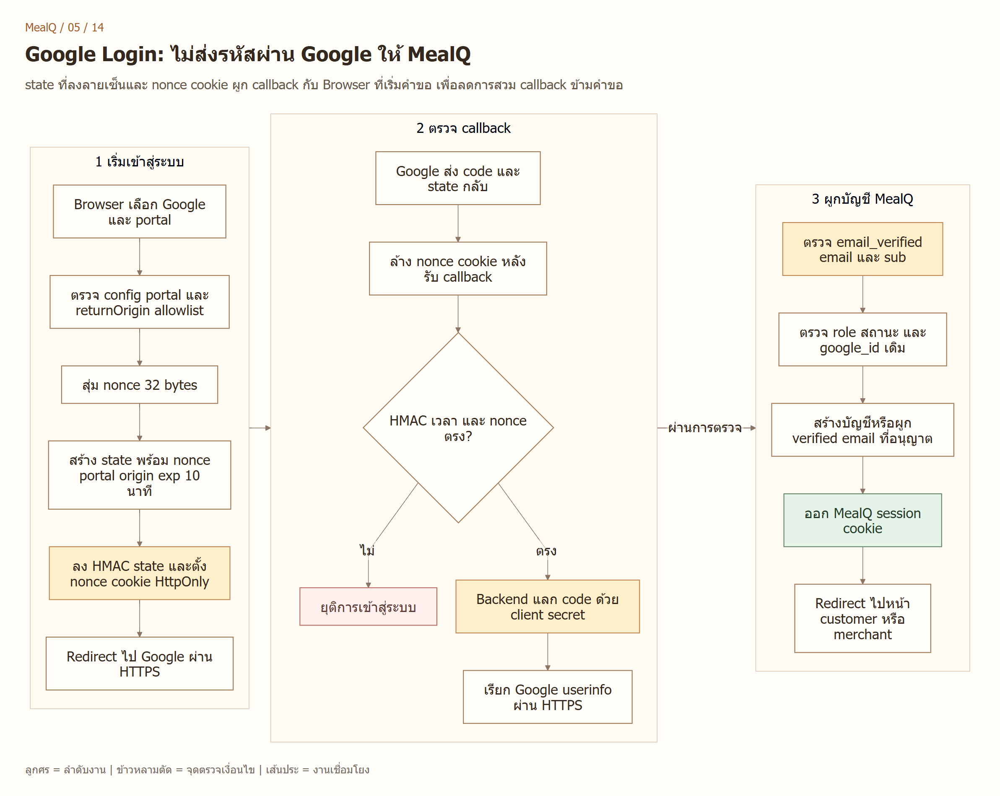

**ข้อมูลและกลไก:** Browser → Google: Google password | Google → Backend: code/userinfo | Backend → Browser: MealQ cookie

1. ผู้ใช้ป้อนรหัสผ่านที่ Google; MealQ ได้ authorization code และข้อมูลผู้ใช้ที่อนุญาต Backend ใช้ access token ระหว่าง callback ไม่พบการบันทึก token นี้ใน User หรือคืนให้ Frontend
2. GOOGLE_CLIENT_SECRET อยู่ Backend และใช้แลก code กับ Google ส่วน client ID เป็นข้อมูลระบุแอปที่เปิดเผยได้ ไม่ใช่รหัสลับ
3. state ใช้ HMAC-SHA256 ตรวจการแก้ไข + nonce cookie อายุ 10 นาที; cookie นี้เป็น SameSite=Lax และ Path เฉพาะ Google auth ต่างจาก session cookie หลัก
4. ห้ามเรียก flow นี้ว่า MealQ มี MFA หรือ PKCE: ไม่พบการบังคับ MFA ในแอปหรือ PKCE ใน flow ปัจจุบัน; บัญชีเดิมที่มี google_id ต้องตรงกับ sub

โค้ดอ้างอิง: [backend/src/controllers/googleAuthController.js](https://github.com/MiniProject-Web-MealQ/food-ordering-platform-mongodb/blob/8d728afd125d27f4beccc506bdd3bd0dafe02662/backend/src/controllers/googleAuthController.js), [backend/src/config/cors.js](https://github.com/MiniProject-Web-MealQ/food-ordering-platform-mongodb/blob/8d728afd125d27f4beccc506bdd3bd0dafe02662/backend/src/config/cors.js), [backend/src/services/session.js](https://github.com/MiniProject-Web-MealQ/food-ordering-platform-mongodb/blob/8d728afd125d27f4beccc506bdd3bd0dafe02662/backend/src/services/session.js), [frontend/src/features/auth/api.js](https://github.com/MiniProject-Web-MealQ/food-ordering-platform-mongodb/blob/8d728afd125d27f4beccc506bdd3bd0dafe02662/frontend/src/features/auth/api.js)

Mermaid สำหรับแก้ไขผัง

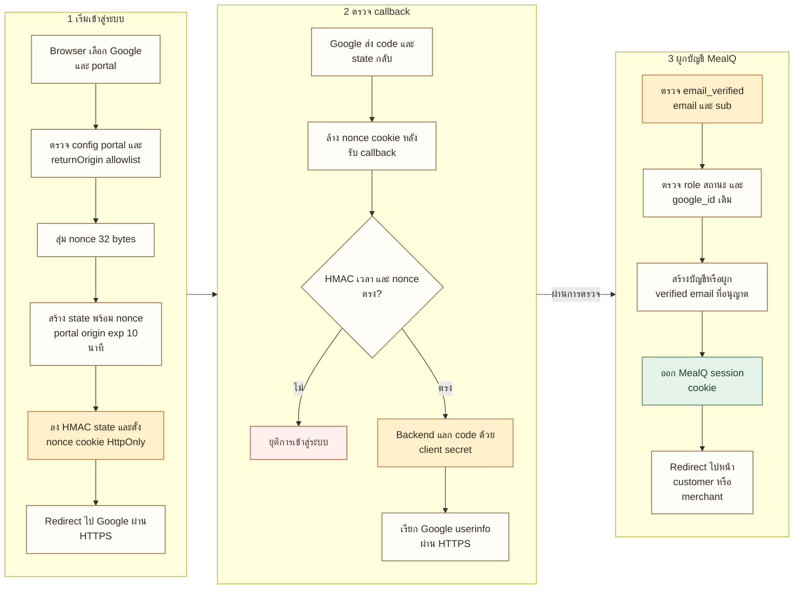

## 06 ลืมและเปลี่ยนรหัสผ่าน: token ใช้ครั้งเดียวและยกเลิก session เก่า

ลิงก์ในอีเมลเป็นสิทธิ์ชั่วคราว ผู้ที่ครอบครองลิงก์ก่อนหมดอายุสามารถตั้งรหัสใหม่ได้

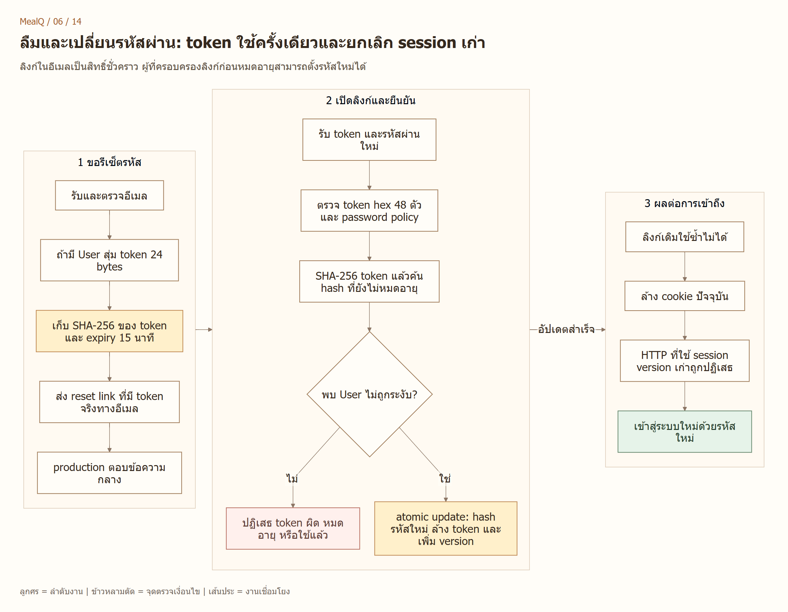

**ข้อมูลและกลไก:** reset token: สุ่ม 24 bytes = hex 48 ตัว | hash: SHA-256 | อายุ: 15 นาที | password ใหม่: scrypt + salt ใหม่

1. ฐานข้อมูลเก็บ reset_token_hash ไม่เก็บ token จริง แต่ token อยู่ในลิงก์อีเมลและ URL จึงต้องดูแลกล่องเมล ประวัติ Browser และ log URL ไม่ให้รั่ว
2. reset ใช้ conditional update ตรวจ hash และ expiry แล้วล้าง token พร้อมเปลี่ยนรหัส จึงลดการใช้ซ้ำ; production ไม่คืน token แต่ development อาจคืน devResetToken
3. เปลี่ยนรหัสจากบัญชีที่ login อยู่ต้องตรวจ current password ก่อน แล้วออก cookie version ใหม่ให้ Browser ปัจจุบัน พร้อม disconnect Socket.IO ของบัญชี
4. ไม่พบ rate limit เฉพาะ forgot/reset; resetPassword เพิ่ม version แต่ยังไม่เรียก disconnectSockets ต่างจาก changePassword จึงควรเสริมการตัด realtime connection เก่าทันที

โค้ดอ้างอิง: [backend/src/controllers/authController.js](https://github.com/MiniProject-Web-MealQ/food-ordering-platform-mongodb/blob/8d728afd125d27f4beccc506bdd3bd0dafe02662/backend/src/controllers/authController.js), [backend/src/services/password.js](https://github.com/MiniProject-Web-MealQ/food-ordering-platform-mongodb/blob/8d728afd125d27f4beccc506bdd3bd0dafe02662/backend/src/services/password.js), [backend/src/services/session.js](https://github.com/MiniProject-Web-MealQ/food-ordering-platform-mongodb/blob/8d728afd125d27f4beccc506bdd3bd0dafe02662/backend/src/services/session.js), [backend/src/routes/authRoutes.js](https://github.com/MiniProject-Web-MealQ/food-ordering-platform-mongodb/blob/8d728afd125d27f4beccc506bdd3bd0dafe02662/backend/src/routes/authRoutes.js)

Mermaid สำหรับแก้ไขผัง

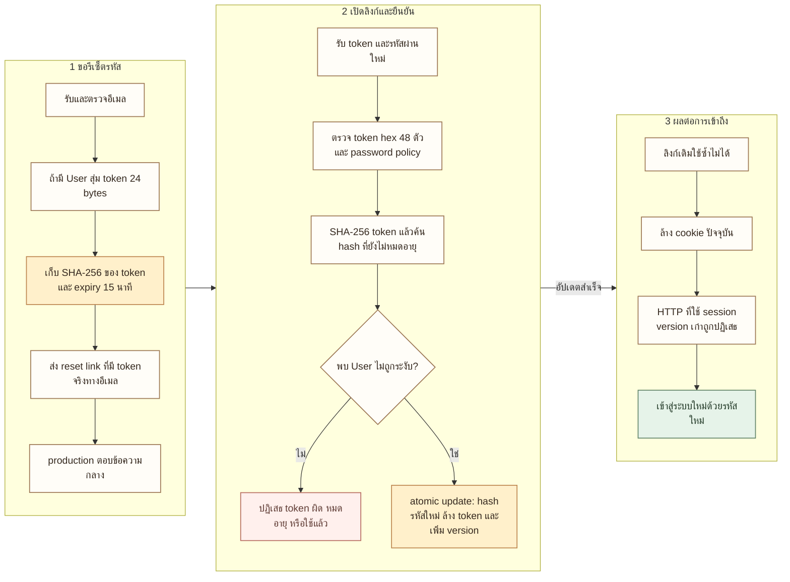

## 07 เปลี่ยนอีเมล: ใช้ session ปัจจุบันและ OTP ของอีเมลใหม่

ผูก challenge กับ user ID อีเมลเดิม และ session version เพื่อไม่ให้คำขอค้างถูกนำมาใช้หลังบัญชีเปลี่ยน

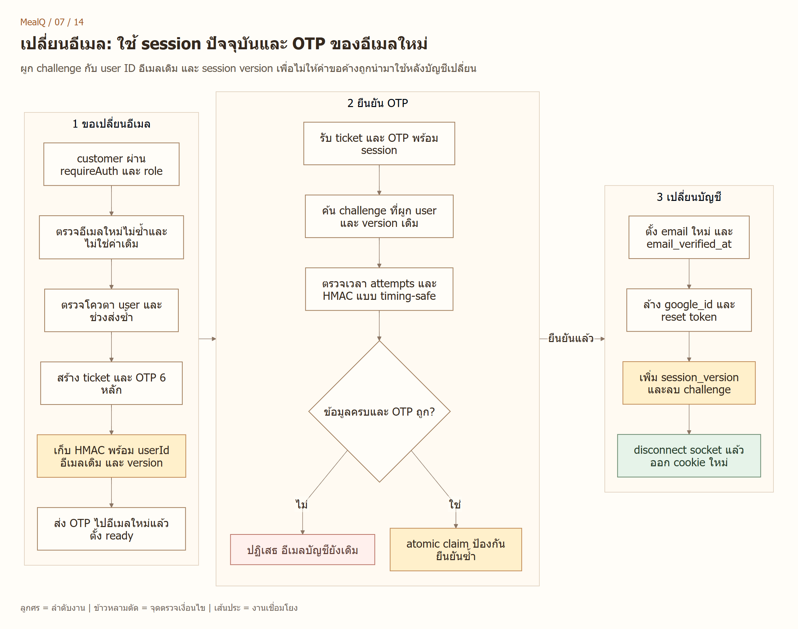

**ข้อมูลและกลไก:** บันทึก OTP เป็น HMAC | ticket ผูกบัญชีและ version | เปลี่ยนอีเมลสำเร็จจึงเปลี่ยน User และ session

1. อายุ OTP 10 นาที ลองได้ 5 ครั้ง; ส่ง OTP สูงสุด 5 ครั้ง/บัญชีในหน้าต่าง 1 ชั่วโมง และเว้น 60 วินาที มี rate limiter เพิ่มอีกชั้น 10 คำขอส่งและ 50 คำขอยืนยัน/user/ชั่วโมง; TTL ทำความสะอาด 24 ชั่วโมง
2. แก้ profile ทั่วไปไม่ยอมเปลี่ยนอีเมลโดยตรง ต้องผ่าน flow นี้ ข้อมูล challenge ไม่สามารถนำไปใช้กับ user อื่นหรือ version ที่เปลี่ยนไปแล้ว
3. หลังเปลี่ยนอีเมลจะยกเลิกการผูก Google เดิมและลิงก์ reset เดิม ส่วน HTTP session เก่าไม่ผ่าน version check; Browser ที่ยืนยันได้รับ cookie ใหม่
4. ข้อจำกัด: flow ปัจจุบันไม่ได้ถาม current password หรือทำ re-auth ก่อนเริ่ม ใช้ session ที่มีอยู่และ OTP กล่องเมลใหม่ จึงควรเสริม step-up สำหรับการเปลี่ยนข้อมูลสำคัญ

โค้ดอ้างอิง: [backend/src/services/email-change.js](https://github.com/MiniProject-Web-MealQ/food-ordering-platform-mongodb/blob/8d728afd125d27f4beccc506bdd3bd0dafe02662/backend/src/services/email-change.js), [backend/src/models/EmailChange.js](https://github.com/MiniProject-Web-MealQ/food-ordering-platform-mongodb/blob/8d728afd125d27f4beccc506bdd3bd0dafe02662/backend/src/models/EmailChange.js), [backend/src/controllers/customerController.js](https://github.com/MiniProject-Web-MealQ/food-ordering-platform-mongodb/blob/8d728afd125d27f4beccc506bdd3bd0dafe02662/backend/src/controllers/customerController.js), [backend/src/routes/customerRoutes.js](https://github.com/MiniProject-Web-MealQ/food-ordering-platform-mongodb/blob/8d728afd125d27f4beccc506bdd3bd0dafe02662/backend/src/routes/customerRoutes.js)

Mermaid สำหรับแก้ไขผัง

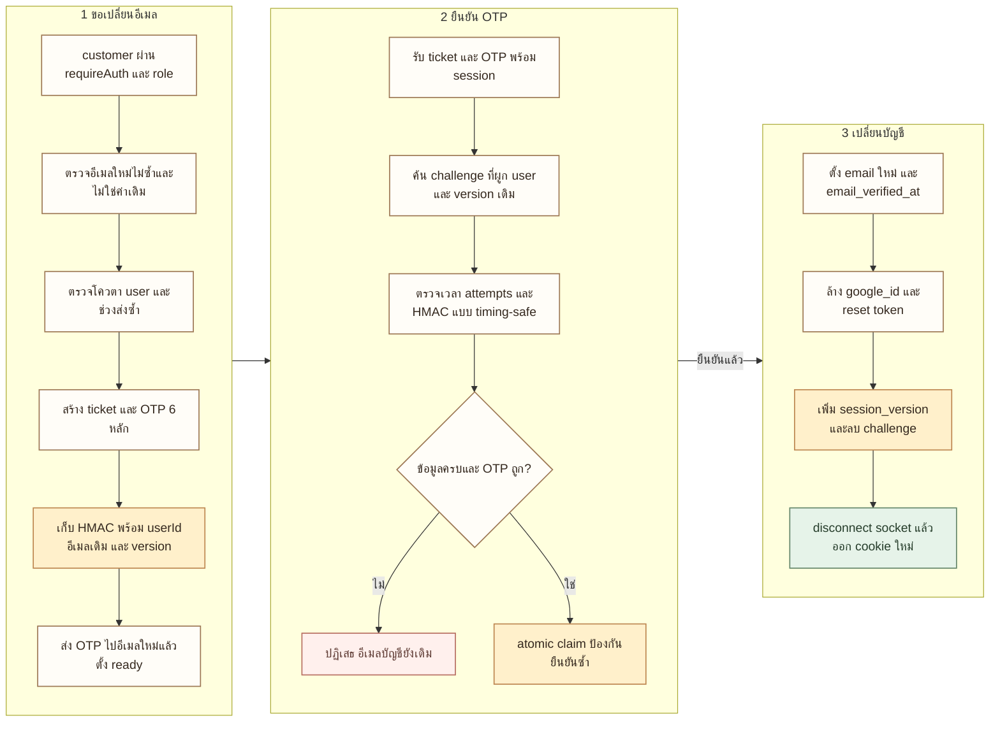

## 08 สั่งซื้อ: เซิร์ฟเวอร์เป็นผู้ตัดสินราคา สต็อก และยอดเงิน

ไม่เชื่อราคา ยอดรวม หรือสถานะจ่ายเงินที่ Browser ส่งมา; ตรวจอีกครั้งเมื่อสร้างออเดอร์จริง

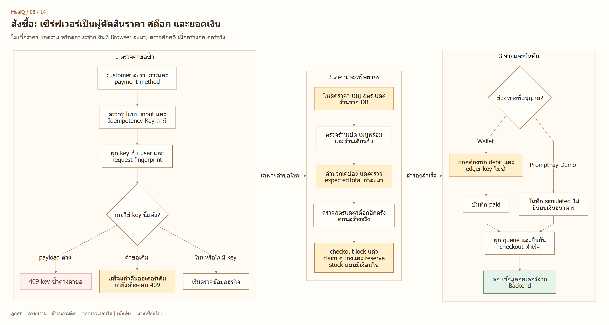

**ข้อมูลและกลไก:** ข้อมูลอ้างอิง: DB ราคา/สูตร/คูปอง | ข้อมูลกันซ้ำ: key + fingerprint | เงิน: Wallet ledger | สต็อก: reservation

1. Frontend preflight ตรวจวัตถุดิบก่อนคิดเงินเพื่อแจ้งผู้ใช้ ส่วน createOrder ตรวจและสำรองซ้ำเพื่อรับมือสต็อกเปลี่ยนระหว่างกดสั่ง; สูตรผูกวัตถุดิบต้องพร้อมก่อนขาย
2. คูปองเลือกได้ 1 ใบต่อออเดอร์ ต้องเป็นสิทธิ์ของลูกค้าและผ่านร้าน วันเวลา ยอดขั้นต่ำ และโควตา; ราคาและตัวเลือกอ้างอิงเมนูในฐานข้อมูล
3. ถ้าส่ง Idempotency-Key จะผูกกับลูกค้าและ fingerprint คำขอ; header ยัง optional สำหรับ legacy clients จึงไม่รับประกันกันซ้ำทุก request ส่วน Wallet ใช้เงื่อนไขยอดเงินและ key ของ ledger
4. ใช้ atomic updates หลายจุด + checkout lock + compensation ไม่ใช่ transaction ครอบทุก collection; ค่าตั้งต้นเป็น Demo รองรับโหมด Wallet และไม่พบ payment gateway ธนาคารจริง; ครั้งนี้ไม่ตรวจ PAYMENT_MODE จริง

โค้ดอ้างอิง: [backend/src/controllers/orderController.js](https://github.com/MiniProject-Web-MealQ/food-ordering-platform-mongodb/blob/8d728afd125d27f4beccc506bdd3bd0dafe02662/backend/src/controllers/orderController.js), [backend/src/services/inventory.js](https://github.com/MiniProject-Web-MealQ/food-ordering-platform-mongodb/blob/8d728afd125d27f4beccc506bdd3bd0dafe02662/backend/src/services/inventory.js), [backend/src/services/order-pricing.js](https://github.com/MiniProject-Web-MealQ/food-ordering-platform-mongodb/blob/8d728afd125d27f4beccc506bdd3bd0dafe02662/backend/src/services/order-pricing.js), [backend/src/services/checkout.js](https://github.com/MiniProject-Web-MealQ/food-ordering-platform-mongodb/blob/8d728afd125d27f4beccc506bdd3bd0dafe02662/backend/src/services/checkout.js), [backend/src/services/payment-config.js](https://github.com/MiniProject-Web-MealQ/food-ordering-platform-mongodb/blob/8d728afd125d27f4beccc506bdd3bd0dafe02662/backend/src/services/payment-config.js), [backend/src/services/wallet.js](https://github.com/MiniProject-Web-MealQ/food-ordering-platform-mongodb/blob/8d728afd125d27f4beccc506bdd3bd0dafe02662/backend/src/services/wallet.js), [backend/src/services/customer-coupons.js](https://github.com/MiniProject-Web-MealQ/food-ordering-platform-mongodb/blob/8d728afd125d27f4beccc506bdd3bd0dafe02662/backend/src/services/customer-coupons.js), [backend/src/models/Order.js](https://github.com/MiniProject-Web-MealQ/food-ordering-platform-mongodb/blob/8d728afd125d27f4beccc506bdd3bd0dafe02662/backend/src/models/Order.js)

Mermaid สำหรับแก้ไขผัง

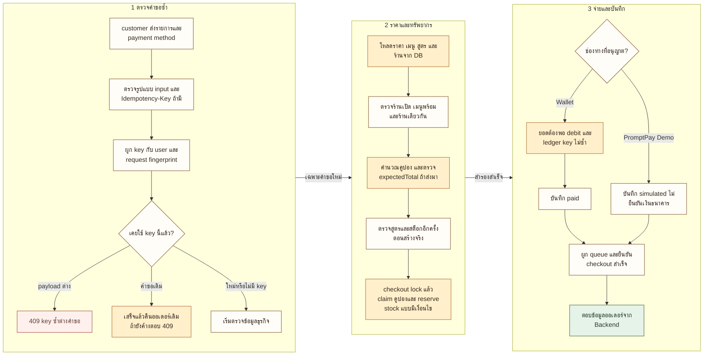

## 09 รับอาหาร ยกเลิก และกู้คืนงานที่ทำไม่ครบ

จำกัดการเปลี่ยนสถานะและใช้เงื่อนไขก่อนคืนทรัพยากร เพื่อลดการรับซ้ำ คืนซ้ำ และข้อมูลค้าง

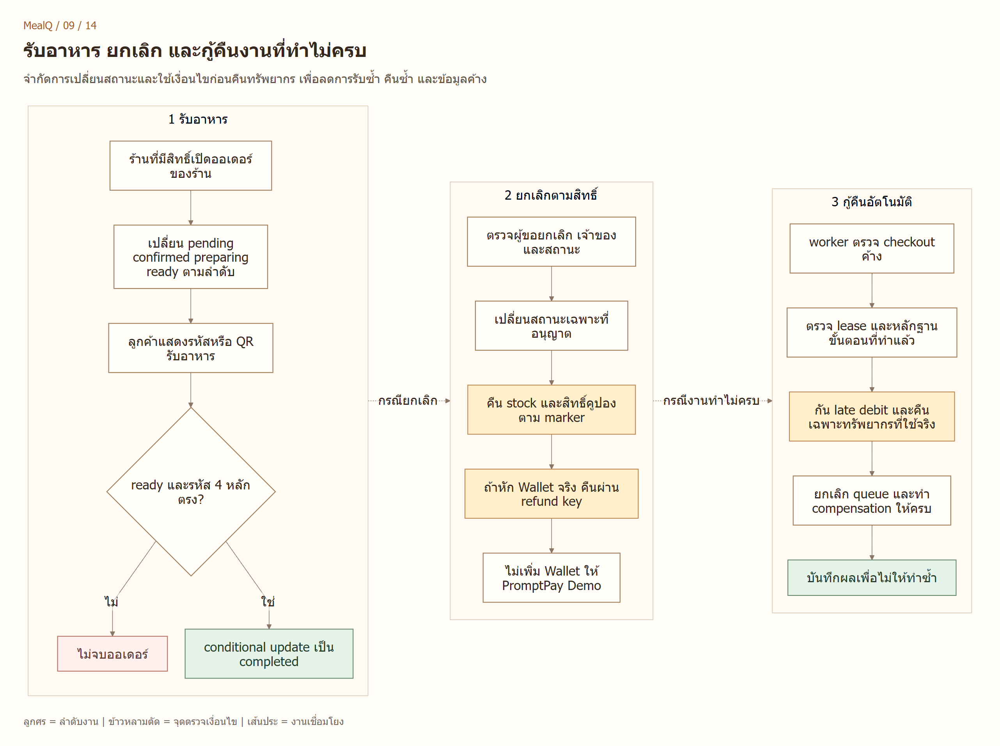

**ข้อมูลและกลไก:** pickup code: 4 หลัก | จบออเดอร์ต้อง ready + code ตรง | refund อ้างอิง debit จริง | recovery ไม่ใช่ DB backup

1. ร้านต้องผ่าน role และ store_id; receiveOrder ตรวจรูปแบบรหัส 4 หลัก ค่า code และสถานะ ready ก่อน compare-and-set เป็น completed จึงปิดงานซ้ำไม่ได้
2. ขอบเขตยกเลิก: ลูกค้า pending/confirmed, ร้านถึง preparing, admin ถึง ready โดยมีเงื่อนไข checkout; ไม่ใช่ทุกบทบาทยกเลิกได้ทุกสถานะ
3. Recovery ทำตอนเริ่มและทุก 30 วินาที สำหรับ checkout ที่ค้างเกิน 2 นาทีและ lease ไม่ทำงาน คืนเฉพาะ debit/stock/coupon ที่มีหลักฐาน durable marker
4. ข้อจำกัดสำคัญ: pickup code อยู่ใน orderView ของร้านด้วย เป็นหลักฐานปฏิบัติงาน ไม่ใช่ความลับที่มีแต่ลูกค้าถือ; ไม่พบ attempt limit หรือ expiry เฉพาะรหัสรับอาหาร

โค้ดอ้างอิง: [backend/src/controllers/merchantController.js](https://github.com/MiniProject-Web-MealQ/food-ordering-platform-mongodb/blob/8d728afd125d27f4beccc506bdd3bd0dafe02662/backend/src/controllers/merchantController.js), [backend/src/controllers/orderController.js](https://github.com/MiniProject-Web-MealQ/food-ordering-platform-mongodb/blob/8d728afd125d27f4beccc506bdd3bd0dafe02662/backend/src/controllers/orderController.js), [backend/src/controllers/adminController.js](https://github.com/MiniProject-Web-MealQ/food-ordering-platform-mongodb/blob/8d728afd125d27f4beccc506bdd3bd0dafe02662/backend/src/controllers/adminController.js), [backend/src/services/order-lifecycle.js](https://github.com/MiniProject-Web-MealQ/food-ordering-platform-mongodb/blob/8d728afd125d27f4beccc506bdd3bd0dafe02662/backend/src/services/order-lifecycle.js), [backend/src/services/checkout-recovery.js](https://github.com/MiniProject-Web-MealQ/food-ordering-platform-mongodb/blob/8d728afd125d27f4beccc506bdd3bd0dafe02662/backend/src/services/checkout-recovery.js)

Mermaid สำหรับแก้ไขผัง

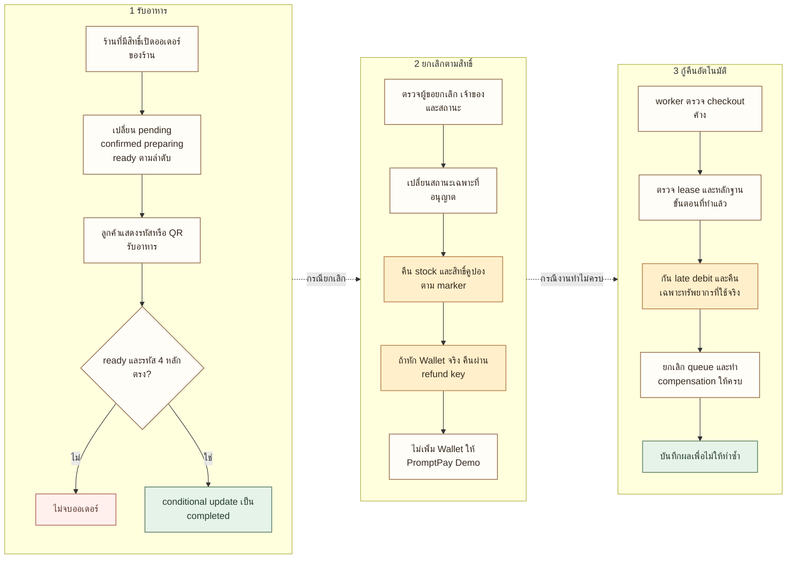

## 10 แจ้งเตือน: ส่งให้บัญชีและอุปกรณ์ที่ถูกคน

Backend เป็นผู้เลือกผู้รับ ไม่ให้ Browser เลือก private room หรืออ่านรายการของบัญชีอื่นจาก ID อย่างเดียว

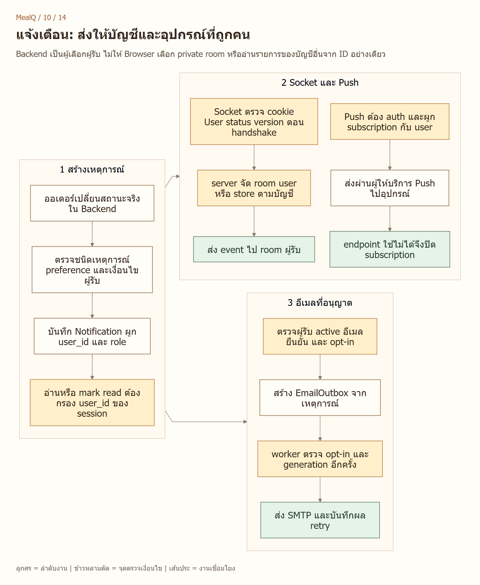

**ข้อมูลและกลไก:** Notification ผูกผู้รับ | Subscription มี endpoint และ keys จึงต้องรักษาสิทธิ์ DB | อีเมลอาจถูกส่งไปผู้ให้บริการภายนอก

1. Socket.IO อนุญาต anonymous connection แต่ไม่เข้าห้อง private; server ตรวจ signed cookie + User + version ตอน handshake แล้วกำหนด room เอง
2. การแจ้งเตือนและ mark read กรองผู้ใช้; merchant notification routes รับเฉพาะเจ้าของร้าน role merchant แม้ routes ปฏิบัติงานร้านบางส่วนให้ staff/admin ใช้ได้
3. อีเมลออเดอร์ต้อง opt-in และ verified email; outbox ตรวจ generation อีกครั้งเพื่อไม่ส่ง backlog หลังปิด/เปิดใหม่ มี retry สูงสุด 5 ครั้ง จึงไม่รับประกันว่าจะถึงกล่องทุกครั้ง
4. Push endpoint จำกัด HTTPS และผู้ให้บริการที่อนุญาต; payload ไม่มี pickup code และ service worker เปิดลิงก์เฉพาะ origin เดิม Socket ตรวจสิทธิ์ตอน handshake ส่วนการส่งภายนอกยังมี crash window จึงไม่ใช่ exactly-once
5. SMTP ขึ้นกับ config โดย Gmail บังคับ STARTTLS เมื่อไม่ใช้ implicit TLS แต่ไม่ได้บังคับ TLS ให้ทุกผู้ให้บริการ; Socket.IO ใช้ CORS config แต่ยังไม่มี allowRequest gate แยกสำหรับตรวจ WebSocket Origin
6. customer ที่ notifyReady=false จะไม่สร้างทั้ง inbox และ push ทุกสถานะ; merchant รับเฉพาะเหตุการณ์ที่กำหนด เช่น ออเดอร์ใหม่ที่จ่ายแล้ว ลูกค้ายกเลิก และรับอาหารเสร็จ โดยมี watermark ร่วมด้วย

โค้ดอ้างอิง: [backend/src/server.js](https://github.com/MiniProject-Web-MealQ/food-ordering-platform-mongodb/blob/8d728afd125d27f4beccc506bdd3bd0dafe02662/backend/src/server.js), [backend/src/services/notifications.js](https://github.com/MiniProject-Web-MealQ/food-ordering-platform-mongodb/blob/8d728afd125d27f4beccc506bdd3bd0dafe02662/backend/src/services/notifications.js), [backend/src/services/order-email.js](https://github.com/MiniProject-Web-MealQ/food-ordering-platform-mongodb/blob/8d728afd125d27f4beccc506bdd3bd0dafe02662/backend/src/services/order-email.js), [backend/src/services/mail.js](https://github.com/MiniProject-Web-MealQ/food-ordering-platform-mongodb/blob/8d728afd125d27f4beccc506bdd3bd0dafe02662/backend/src/services/mail.js), [frontend/public/push-sw.js](https://github.com/MiniProject-Web-MealQ/food-ordering-platform-mongodb/blob/8d728afd125d27f4beccc506bdd3bd0dafe02662/frontend/public/push-sw.js), [backend/src/models/PushSubscription.js](https://github.com/MiniProject-Web-MealQ/food-ordering-platform-mongodb/blob/8d728afd125d27f4beccc506bdd3bd0dafe02662/backend/src/models/PushSubscription.js), [backend/src/models/EmailOutbox.js](https://github.com/MiniProject-Web-MealQ/food-ordering-platform-mongodb/blob/8d728afd125d27f4beccc506bdd3bd0dafe02662/backend/src/models/EmailOutbox.js), [backend/src/routes/customerRoutes.js](https://github.com/MiniProject-Web-MealQ/food-ordering-platform-mongodb/blob/8d728afd125d27f4beccc506bdd3bd0dafe02662/backend/src/routes/customerRoutes.js), [backend/src/routes/merchantRoutes.js](https://github.com/MiniProject-Web-MealQ/food-ordering-platform-mongodb/blob/8d728afd125d27f4beccc506bdd3bd0dafe02662/backend/src/routes/merchantRoutes.js)

Mermaid สำหรับแก้ไขผัง

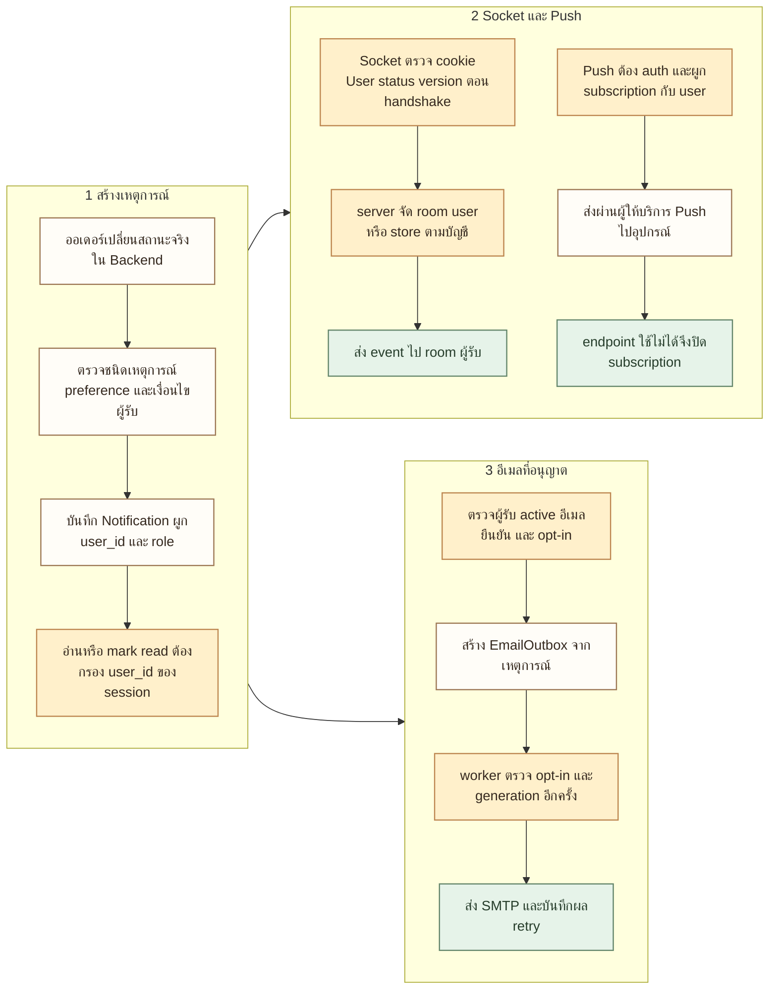

## 11 Browser รูปภาพ และข้อมูลที่เปิดเผยต่อสาธารณะ

ป้องกันข้อมูลฝั่งหน้าเว็บด้วยการจำกัดการเก็บและการแสดงผล พร้อมแยกข้อมูลส่วนตัวออกจากข้อมูลที่ตั้งใจเผยแพร่

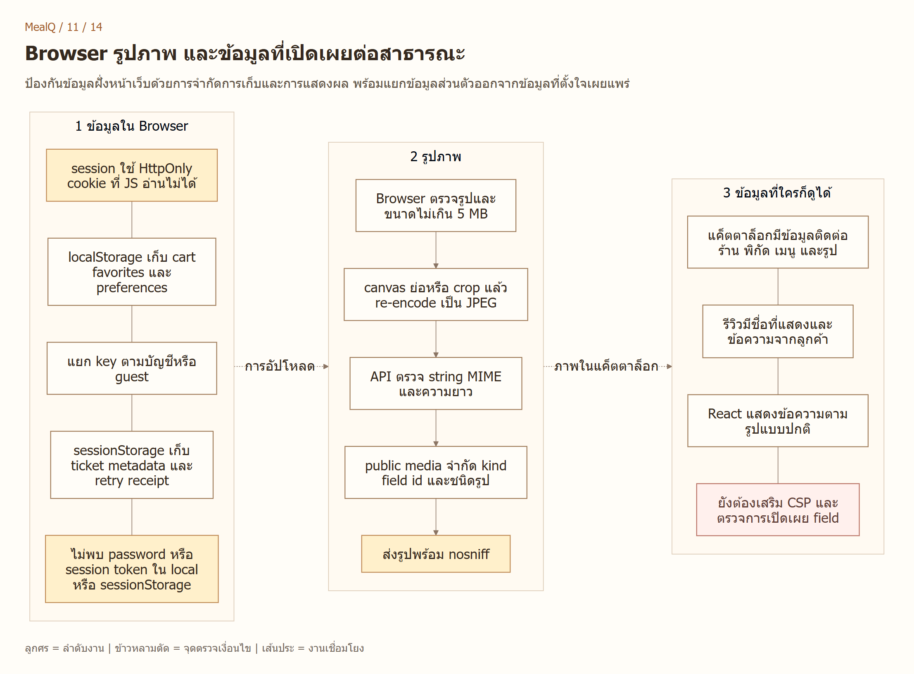

**ข้อมูลและกลไก:** เส้นไม่มีหัวลูกศร = รายการในกลุ่ม | Browser storage ≠ ที่เก็บ secret | MIME ≠ ยืนยันเนื้อไฟล์ปลอดภัย

1. state ที่ persist ตัด user/orders/coupons ออก แต่ยังมี cart, favorites, notification summaries และ preferences จึงห้ามอ้างว่า Browser ไม่เก็บข้อมูลผู้ใช้เลย; เครื่องที่ใช้ร่วมกันยังต้องดูแลข้อมูลค้าง
2. ไม่พบ dangerouslySetInnerHTML หรือ eval ในการค้น frontend ปัจจุบัน ใช้ React text rendering ตามปกติ; นี่ไม่ใช่หลักฐานว่าป้องกัน XSS ได้ทุกทางหรือมี sanitizer ครบ
3. Server ตรวจรูปด้วยรูปแบบ string/MIME ไม่ได้ถอด bytes ตรวจ signature/dimension หรือสแกน malware; frontend validation ไม่แทน server validation และยังรับ URL รูปภายนอก HTTP(S)
4. ข้อมูล public มี store statusNote, สูตร ingredient ID/ปริมาณในเมนู และชื่อ/อ้างอิงออเดอร์ในรีวิว; ควรทบทวน data minimization ส่วน CSV export ยังไม่ neutralize formula prefixes

โค้ดอ้างอิง: [frontend/src/features/customer/customer-provider.jsx](https://github.com/MiniProject-Web-MealQ/food-ordering-platform-mongodb/blob/8d728afd125d27f4beccc506bdd3bd0dafe02662/frontend/src/features/customer/customer-provider.jsx), [frontend/src/features/customer/store.js](https://github.com/MiniProject-Web-MealQ/food-ordering-platform-mongodb/blob/8d728afd125d27f4beccc506bdd3bd0dafe02662/frontend/src/features/customer/store.js), [frontend/src/features/customer/checkout-attempt.js](https://github.com/MiniProject-Web-MealQ/food-ordering-platform-mongodb/blob/8d728afd125d27f4beccc506bdd3bd0dafe02662/frontend/src/features/customer/checkout-attempt.js), [frontend/src/features/merchant/image.js](https://github.com/MiniProject-Web-MealQ/food-ordering-platform-mongodb/blob/8d728afd125d27f4beccc506bdd3bd0dafe02662/frontend/src/features/merchant/image.js), [backend/src/services/menu-validation.js](https://github.com/MiniProject-Web-MealQ/food-ordering-platform-mongodb/blob/8d728afd125d27f4beccc506bdd3bd0dafe02662/backend/src/services/menu-validation.js), [backend/src/services/media.js](https://github.com/MiniProject-Web-MealQ/food-ordering-platform-mongodb/blob/8d728afd125d27f4beccc506bdd3bd0dafe02662/backend/src/services/media.js), [backend/src/controllers/publicController.js](https://github.com/MiniProject-Web-MealQ/food-ordering-platform-mongodb/blob/8d728afd125d27f4beccc506bdd3bd0dafe02662/backend/src/controllers/publicController.js), [frontend/src/features/admin/csv.js](https://github.com/MiniProject-Web-MealQ/food-ordering-platform-mongodb/blob/8d728afd125d27f4beccc506bdd3bd0dafe02662/frontend/src/features/admin/csv.js)

Mermaid สำหรับแก้ไขผัง

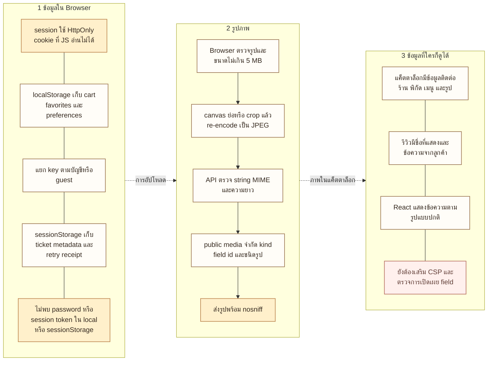

## 12 เก็บข้อมูลอะไร และส่วนใดเป็นความลับ

จำแนกข้อมูลที่แฮช ข้อมูลที่อ่านได้ และกุญแจฝั่งเซิร์ฟเวอร์ เพื่อไม่สับสนว่าทั้งฐานข้อมูลถูกเข้ารหัสแล้ว

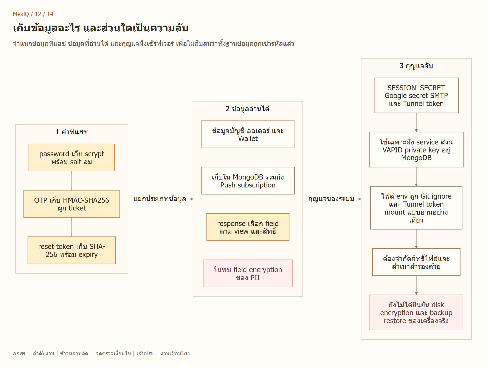

**ข้อมูลและกลไก:** Hash ใช้ตรวจความถูกต้อง | Signature ใช้ตรวจการแก้ไข | Encryption ใช้ปกปิดข้อมูล | Backup ใช้กู้คืน

1. User response แบบ userView ไม่คืน password_hash, reset_token_hash, session_version หรือ google_id; แต่การจำกัด response ไม่ได้เข้ารหัสข้อมูลในฐานข้อมูล
2. SESSION_SECRET ใช้กับลายเซ็น session/state และ HMAC บาง flow; ฟังก์ชันสร้าง/ตรวจ session ปฏิเสธค่าว่างหรือค่าตัวอย่างที่กำหนดเมื่อเป็น production ไม่ใช่ startup validation ครอบทุก flow; เปลี่ยน key กระทบ token เดิม
3. Git ignore ช่วยไม่ stage ไฟล์ลับตามปกติ แต่ไม่เข้ารหัสไฟล์ ไม่ถอน secret ที่เคย commit และไม่ป้องกันผู้ที่อ่านไฟล์บนเครื่องได้; ไม่คัดลอก secret จริงเข้าเอกสารนี้
4. การสำรองช่วยเรื่องกู้คืน ไม่ใช่การเข้ารหัสโดยตัวมันเอง ต้องจำกัดผู้เข้าถึง เข้ารหัสสำเนา และทดสอบ restore; การตรวจครั้งนี้เป็น source audit จึงไม่ยืนยันการตั้งค่าหรือ backup เครื่องจริง

โค้ดอ้างอิง: [backend/src/models/User.js](https://github.com/MiniProject-Web-MealQ/food-ordering-platform-mongodb/blob/8d728afd125d27f4beccc506bdd3bd0dafe02662/backend/src/models/User.js), [backend/src/services/password.js](https://github.com/MiniProject-Web-MealQ/food-ordering-platform-mongodb/blob/8d728afd125d27f4beccc506bdd3bd0dafe02662/backend/src/services/password.js), [backend/src/services/session.js](https://github.com/MiniProject-Web-MealQ/food-ordering-platform-mongodb/blob/8d728afd125d27f4beccc506bdd3bd0dafe02662/backend/src/services/session.js), [backend/src/services/user-view.js](https://github.com/MiniProject-Web-MealQ/food-ordering-platform-mongodb/blob/8d728afd125d27f4beccc506bdd3bd0dafe02662/backend/src/services/user-view.js), [backend/src/models/PushSubscription.js](https://github.com/MiniProject-Web-MealQ/food-ordering-platform-mongodb/blob/8d728afd125d27f4beccc506bdd3bd0dafe02662/backend/src/models/PushSubscription.js), [backend/src/models/PushConfig.js](https://github.com/MiniProject-Web-MealQ/food-ordering-platform-mongodb/blob/8d728afd125d27f4beccc506bdd3bd0dafe02662/backend/src/models/PushConfig.js), [.gitignore](https://github.com/MiniProject-Web-MealQ/food-ordering-platform-mongodb/blob/8d728afd125d27f4beccc506bdd3bd0dafe02662/.gitignore), [.dockerignore](https://github.com/MiniProject-Web-MealQ/food-ordering-platform-mongodb/blob/8d728afd125d27f4beccc506bdd3bd0dafe02662/.dockerignore), [backend/.env.example](https://github.com/MiniProject-Web-MealQ/food-ordering-platform-mongodb/blob/8d728afd125d27f4beccc506bdd3bd0dafe02662/backend/.env.example), [deploy/tunnel.compose.yaml](https://github.com/MiniProject-Web-MealQ/food-ordering-platform-mongodb/blob/8d728afd125d27f4beccc506bdd3bd0dafe02662/deploy/tunnel.compose.yaml)

Mermaid สำหรับแก้ไขผัง

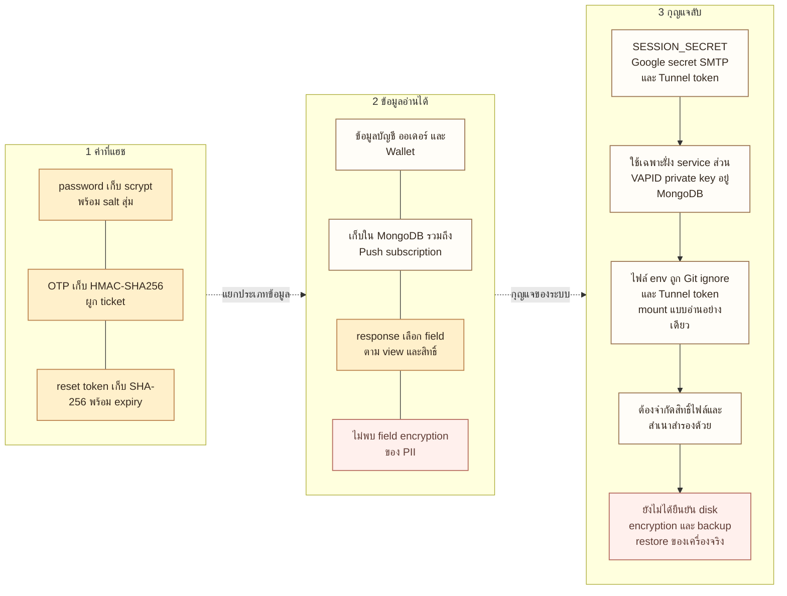

## 13 สำรองและกู้คืน: รักษาทั้งความลับและความพร้อมใช้

ผังนี้อธิบายสคริปต์ที่มีใน repository เท่านั้น ยังไม่ยืนยันว่า schedule ล่าสุดทำงานหรือ restore สำเร็จบนเครื่องจริง

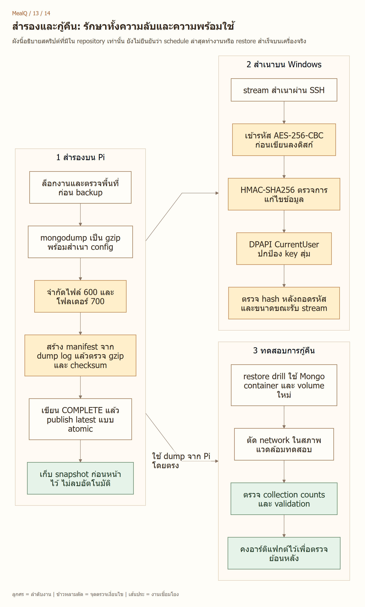

**ข้อมูลและกลไก:** Pi: plaintext + permissions | SSH: เข้ารหัสระหว่างส่ง | Windows: AES + HMAC + DPAPI | Restore: ทดสอบแยกจากระบบจริง

1. บน Pi snapshot เป็นไฟล์ gzip และสำเนา config ที่ยังเป็น plaintext แม้สิทธิ์ owner-only จึงมีทั้งข้อมูลผู้ใช้และ secret ที่ต้องดูแล; gzip คือการบีบอัด ไม่ใช่ encryption
2. สำเนา Windows ใช้ encrypt-then-HMAC และ DPAPI ผูก key กับ Windows user ปัจจุบัน การกู้คืนจึงต้องมีสิทธิ์/กุญแจที่เกี่ยวข้อง; ไม่ได้อ้างว่า backup บน Pi ถูกเข้ารหัสด้วย
3. Online mongodump จาก standalone MongoDB เป็น collection-level copy ไม่ใช่ snapshot ที่ atomic ข้ามทุก collection; การตรวจ checksum ยืนยันไฟล์คงเดิม ไม่รับประกันความสอดคล้องธุรกิจทุกกรณี
4. สคริปต์มี daily task ที่ต้อง user sign in และตรวจ backup เก่าเกิน 36 ชั่วโมง แต่ครั้งนี้ไม่ได้อ่านรายงานจริง จึงไม่ระบุ RPO/RTO หรือรับประกันว่ามี backup/restore ล่าสุดสำเร็จ

โค้ดอ้างอิง: [deploy/backup-pi.sh](https://github.com/MiniProject-Web-MealQ/food-ordering-platform-mongodb/blob/8d728afd125d27f4beccc506bdd3bd0dafe02662/deploy/backup-pi.sh), [deploy/backup-windows-crypto.ps1](https://github.com/MiniProject-Web-MealQ/food-ordering-platform-mongodb/blob/8d728afd125d27f4beccc506bdd3bd0dafe02662/deploy/backup-windows-crypto.ps1), [deploy/backup-sync-windows.ps1](https://github.com/MiniProject-Web-MealQ/food-ordering-platform-mongodb/blob/8d728afd125d27f4beccc506bdd3bd0dafe02662/deploy/backup-sync-windows.ps1), [deploy/backup-install-windows.ps1](https://github.com/MiniProject-Web-MealQ/food-ordering-platform-mongodb/blob/8d728afd125d27f4beccc506bdd3bd0dafe02662/deploy/backup-install-windows.ps1), [deploy/backup-restore-drill.sh](https://github.com/MiniProject-Web-MealQ/food-ordering-platform-mongodb/blob/8d728afd125d27f4beccc506bdd3bd0dafe02662/deploy/backup-restore-drill.sh)

Mermaid สำหรับแก้ไขผัง

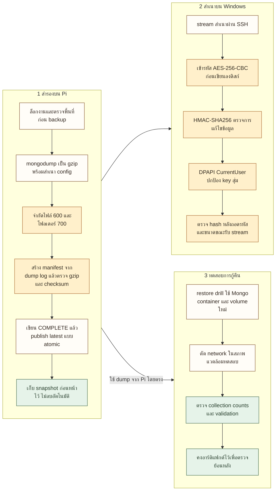

## 14 สิ่งที่ยังควรเสริมก่อนยกระดับใช้งานจริง

หน้านี้เป็นข้อเสนอจากการอ่านโค้ด ไม่ใช่ฟังก์ชันที่เพิ่มแล้ว และไม่ใช่ผลทดสอบเจาะระบบ

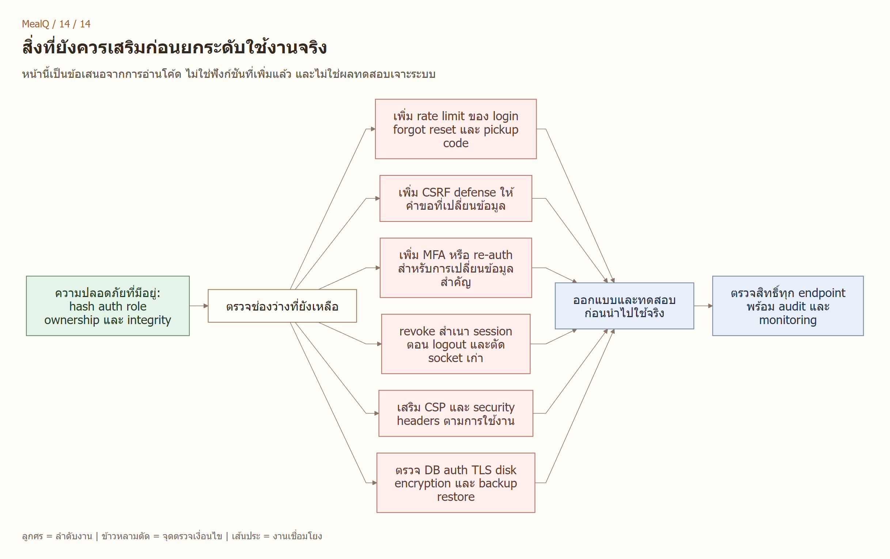

**ข้อมูลและกลไก:** ลำดับแนะนำ: ปิดช่อง abuse/CSRF → เพิ่ม re-auth/revocation → ตรวจ runtime/storage → ทดสอบสิทธิ์และเฝ้าระวัง

1. ควรเริ่มจาก rate limit ในช่องทางเสี่ยงและ CSRF defense: session บน HTTPS ใช้ SameSite=None; CORS กับ HttpOnly ช่วยคนละเรื่องและไม่ใช่ CSRF protection ที่ครบถ้วน
2. Logout ปัจจุบันลบ cookie เท่านั้น; เพิ่มการ revoke ที่เหมาะกับ per-session/device และตรวจสิทธิ์/อายุของ Socket.IO ต่อเนื่อง โดยระวังผลต่ออุปกรณ์ที่ใช้งานอยู่
3. ไม่พบ MFA, CSP/Helmet หรือ field encryption ในแอป; การเพิ่มต้องออกแบบให้ตรงความเสี่ยง อย่าอ้างว่าการมีไลบรารีหรือเครือข่ายภายในทำให้ปลอดภัยทุกกรณี
4. ตรวจ runtime แยกจาก source: Mongo authentication, firewall, TLS, secret permissions/rotation, patching, encrypted backup และ restore drill ยังไม่ยืนยันจากงานเอกสารนี้

โค้ดอ้างอิง: [backend/src/routes/authRoutes.js](https://github.com/MiniProject-Web-MealQ/food-ordering-platform-mongodb/blob/8d728afd125d27f4beccc506bdd3bd0dafe02662/backend/src/routes/authRoutes.js), [backend/src/controllers/authController.js](https://github.com/MiniProject-Web-MealQ/food-ordering-platform-mongodb/blob/8d728afd125d27f4beccc506bdd3bd0dafe02662/backend/src/controllers/authController.js), [backend/src/services/session.js](https://github.com/MiniProject-Web-MealQ/food-ordering-platform-mongodb/blob/8d728afd125d27f4beccc506bdd3bd0dafe02662/backend/src/services/session.js), [backend/src/controllers/merchantController.js](https://github.com/MiniProject-Web-MealQ/food-ordering-platform-mongodb/blob/8d728afd125d27f4beccc506bdd3bd0dafe02662/backend/src/controllers/merchantController.js), [backend/src/server.js](https://github.com/MiniProject-Web-MealQ/food-ordering-platform-mongodb/blob/8d728afd125d27f4beccc506bdd3bd0dafe02662/backend/src/server.js), [backend/src/config/db.js](https://github.com/MiniProject-Web-MealQ/food-ordering-platform-mongodb/blob/8d728afd125d27f4beccc506bdd3bd0dafe02662/backend/src/config/db.js), [backend/src/controllers/googleAuthController.js](https://github.com/MiniProject-Web-MealQ/food-ordering-platform-mongodb/blob/8d728afd125d27f4beccc506bdd3bd0dafe02662/backend/src/controllers/googleAuthController.js)

Mermaid สำหรับแก้ไขผัง

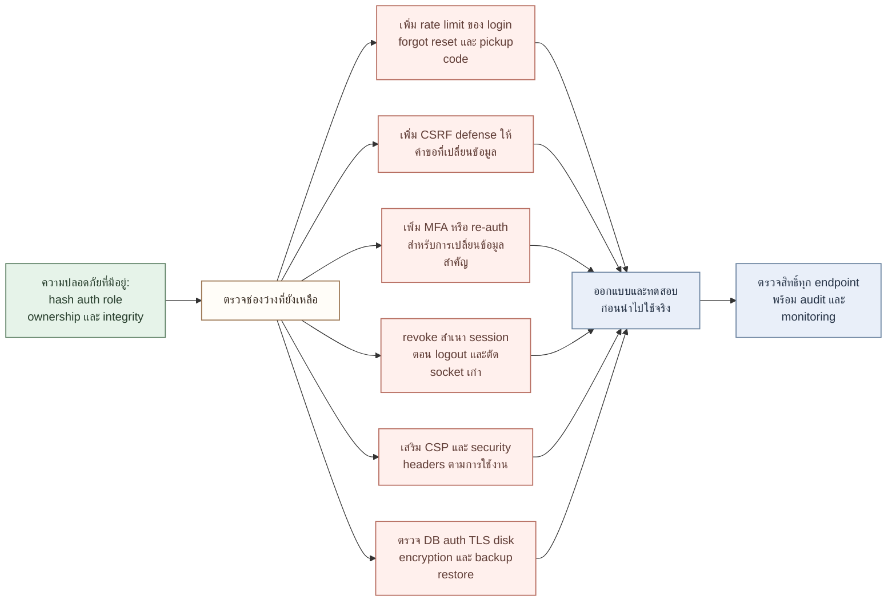

