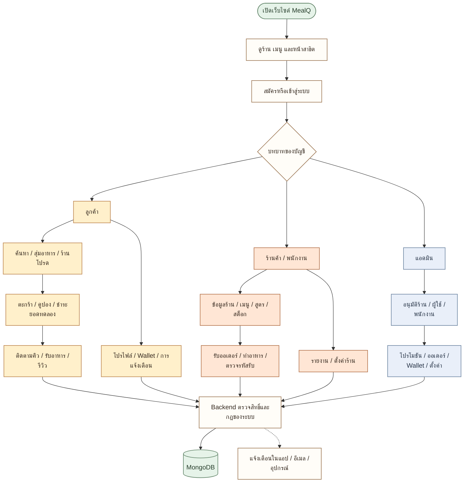
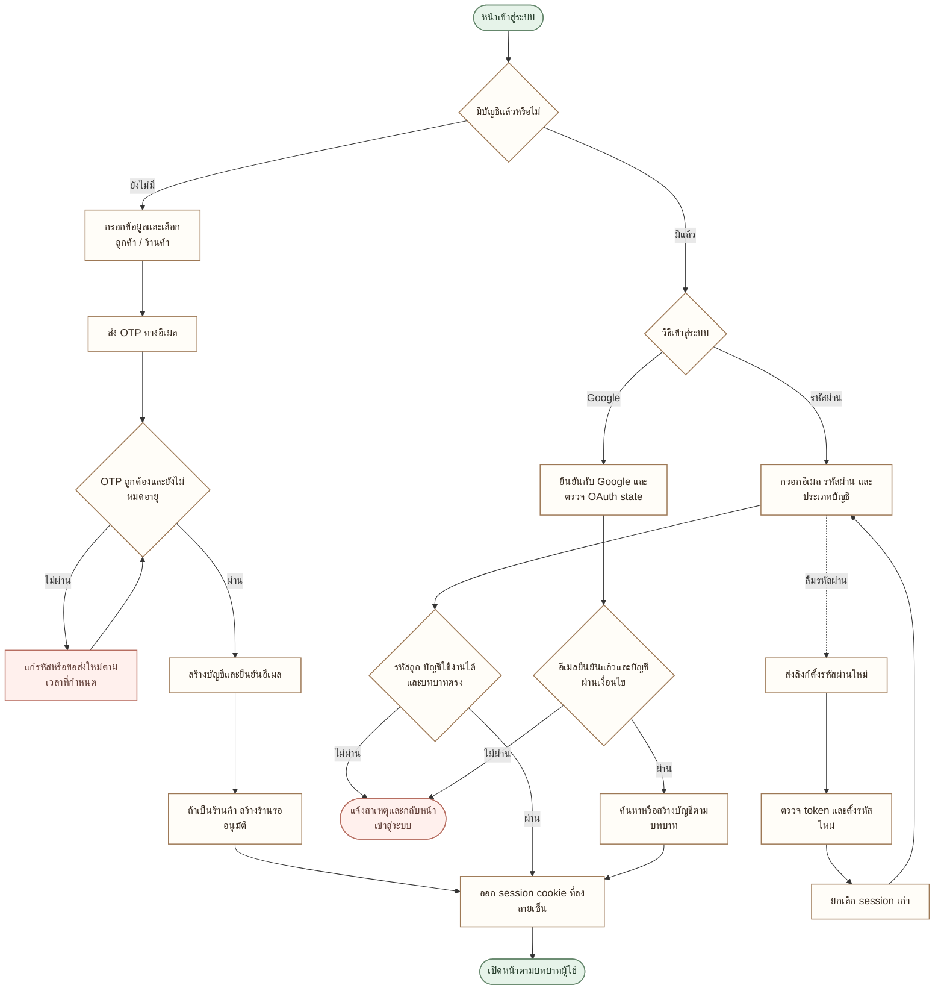
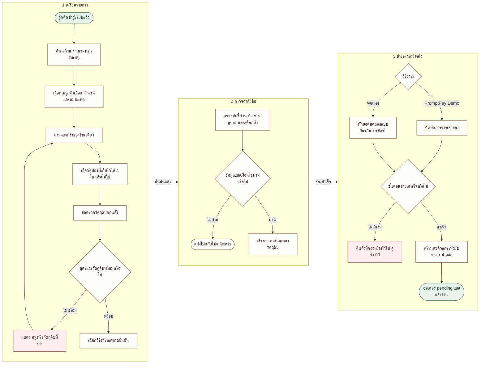
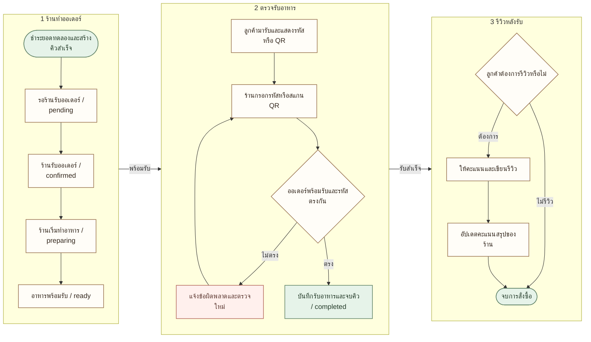
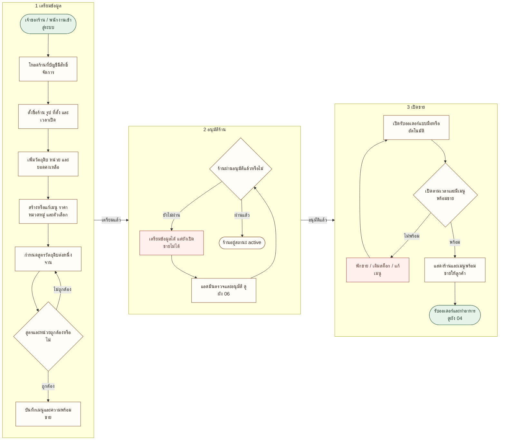
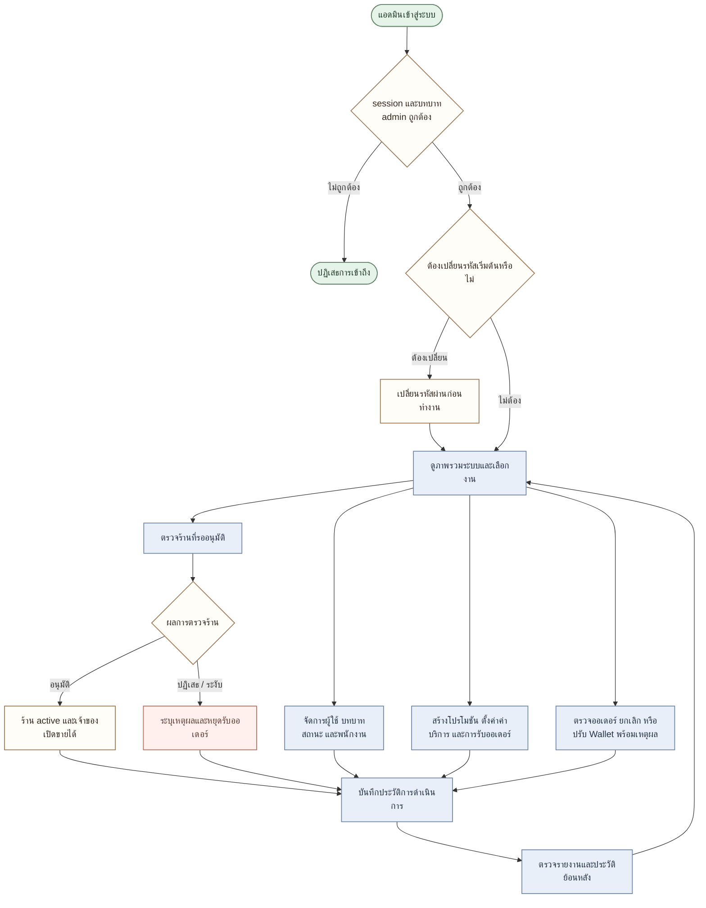
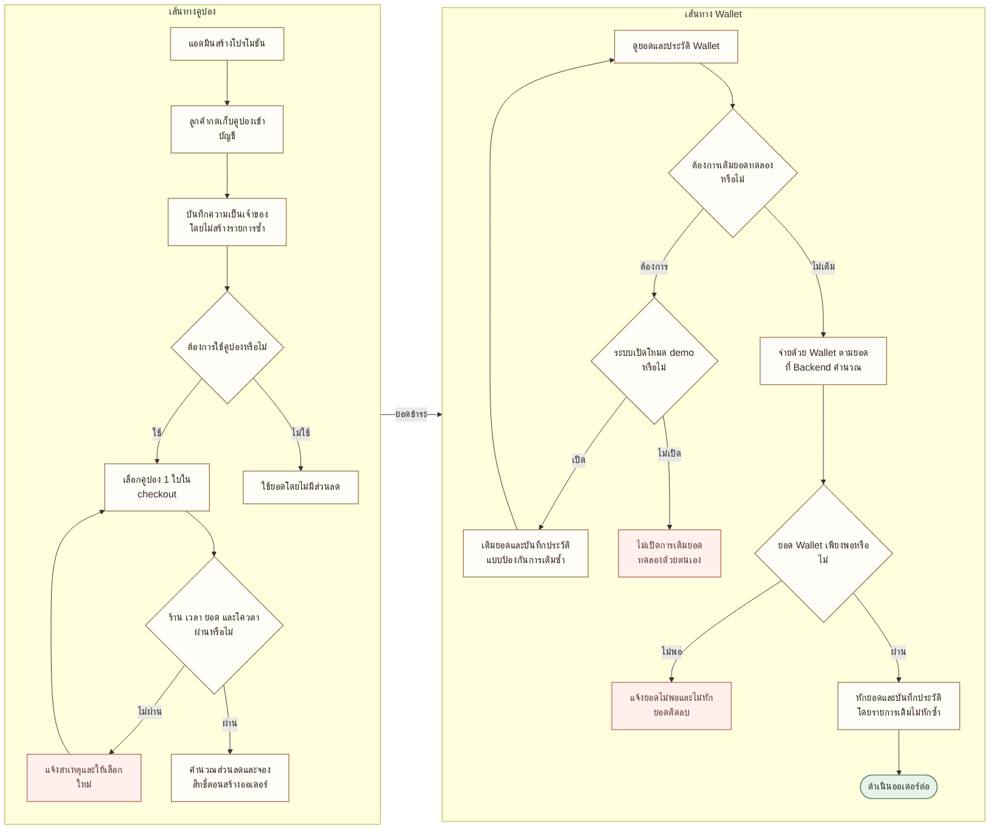
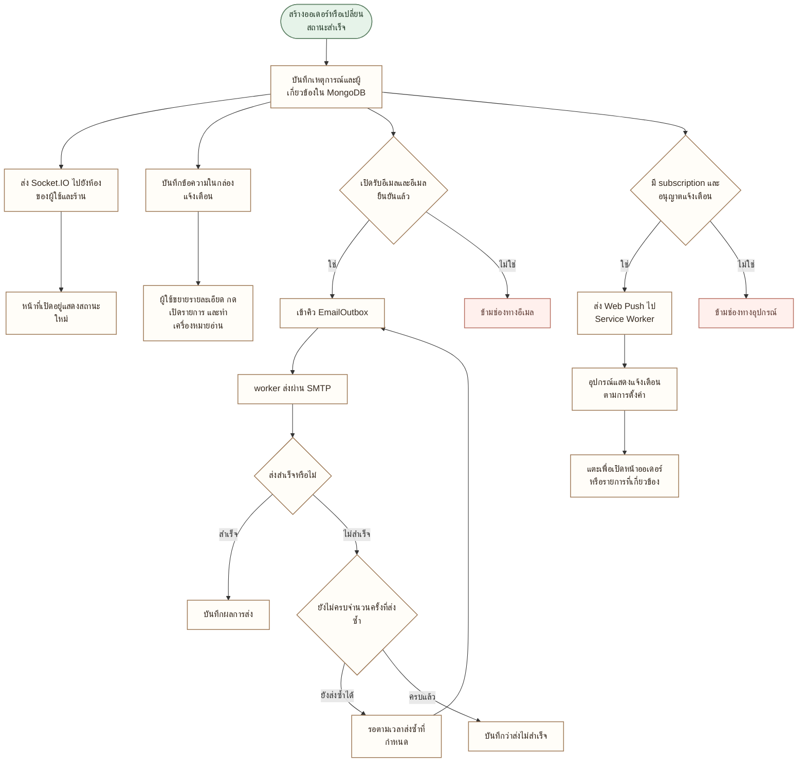
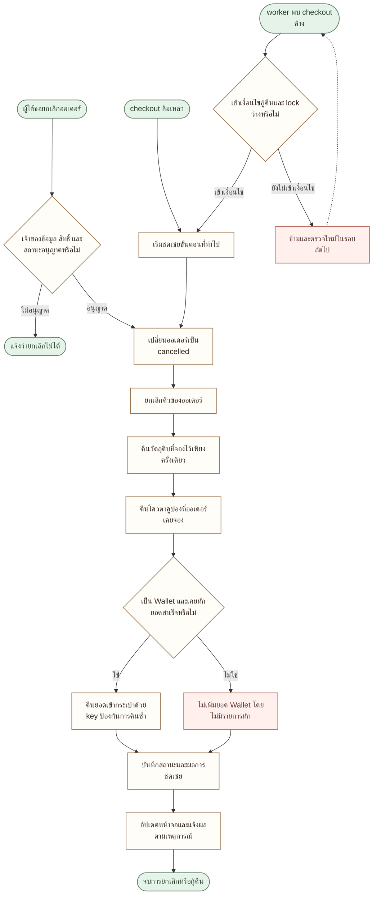
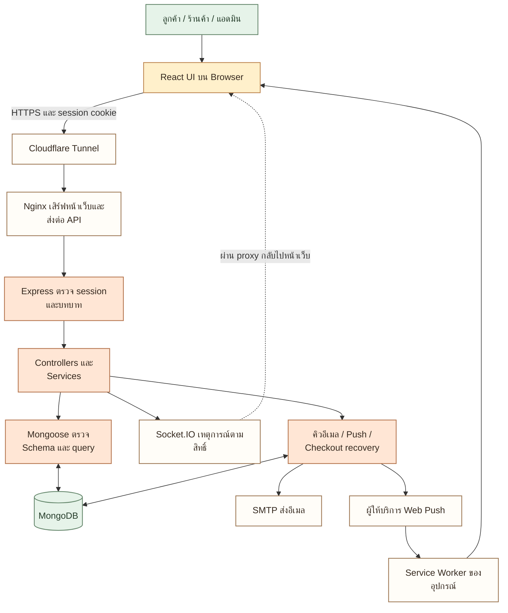

# ผังการทำงานของระบบ MealQ

ชุดผังนี้แบ่งงานเป็น 10 ส่วน เริ่มอ่านผัง 01 เพื่อดูภาพรวม แล้วเปิดผังเฉพาะเรื่องตามลำดับ ตารางด้านล่างมีภาพ PNG สำหรับใส่รายงานหรือสไลด์ SVG สำหรับขยายภาพ และ Mermaid สำหรับแก้ไขผังต่อ

[อ่าน PDF รวมทุกผัง](MealQ-System-Workflows.pdf) มีสารบัญเลือกหน้าในตัว PDF และขยายอ่านข้อความได้ชัดเจน

สัญลักษณ์: กล่องคือกิจกรรม ข้าวหลามตัดคือเงื่อนไข ทรงกระบอกคือฐานข้อมูล ลูกศรทึบคือลำดับงาน และเส้นประคืองานที่เชื่อมโยงหรือการแจ้งเหตุการณ์

| ผัง | เนื้อหา | ไฟล์ |
|---|---|---|
| 01 | ภาพรวมการทำงานของ MealQ | [PNG](png/01-system-overview.png) · [SVG](svg/01-system-overview.svg) · [Mermaid](mermaid/01-system-overview.mmd) |
| 02 | สมัครสมาชิกและเข้าสู่ระบบ | [PNG](png/02-account-access.png) · [SVG](svg/02-account-access.svg) · [Mermaid](mermaid/02-account-access.mmd) |
| 03 | ลูกค้าเลือกอาหารและสั่งซื้อ | [PNG](png/03-customer-checkout.png) · [SVG](svg/03-customer-checkout.svg) · [Mermaid](mermaid/03-customer-checkout.mmd) |
| 04 | จากร้านรับออเดอร์จนลูกค้าได้รับอาหาร | [PNG](png/04-order-fulfilment.png) · [SVG](svg/04-order-fulfilment.svg) · [Mermaid](mermaid/04-order-fulfilment.mmd) |
| 05 | ร้านค้าตั้งค่าร้าน เมนู และวัตถุดิบ | [PNG](png/05-merchant-operation.png) · [SVG](svg/05-merchant-operation.svg) · [Mermaid](mermaid/05-merchant-operation.mmd) |
| 06 | การทำงานของแอดมิน | [PNG](png/06-admin-operation.png) · [SVG](svg/06-admin-operation.svg) · [Mermaid](mermaid/06-admin-operation.mmd) |
| 07 | คูปองและ Wallet ทดลอง | [PNG](png/07-coupon-wallet.png) · [SVG](svg/07-coupon-wallet.svg) · [Mermaid](mermaid/07-coupon-wallet.mmd) |
| 08 | การอัปเดตสถานะและแจ้งเตือน | [PNG](png/08-notification-delivery.png) · [SVG](svg/08-notification-delivery.svg) · [Mermaid](mermaid/08-notification-delivery.mmd) |
| 09 | ยกเลิกออเดอร์และกู้คืน checkout ที่ค้าง | [PNG](png/09-cancel-recovery.png) · [SVG](svg/09-cancel-recovery.svg) · [Mermaid](mermaid/09-cancel-recovery.mmd) |
| 10 | ระบบแต่ละส่วนเชื่อมกันอย่างไร | [PNG](png/10-system-architecture.png) · [SVG](svg/10-system-architecture.svg) · [Mermaid](mermaid/10-system-architecture.mmd) |

การชำระเงินเป็น Demo ไม่มีการรับเงินจริงผ่านธนาคาร ผังเป็นภาพระดับขั้นตอนงาน กรณีส่งซ้ำและคืนทรัพยากรยังต้องผ่านตัวป้องกันการทำซ้ำใน Backend ตามเดิม

## 01 ภาพรวมการทำงานของ MealQ

เริ่มจากบทบาทผู้ใช้ แล้วเชื่อมงานทุกส่วนผ่าน Backend เดียวกัน

- ลูกค้าและร้านค้าใช้หน้า /login ส่วนแอดมินใช้ /admin/login
- พนักงานใช้ส่วนงานของร้านที่แอดมินมอบหมาย การตั้งค่าแจ้งเตือนร้านเป็นของเจ้าของร้าน
- ลูกค้าค้นหาร้าน สุ่มอาหาร ดูร้านโปรด และดูข้อมูลสาธารณะได้ตามหน้าที่ระบบเปิดไว้ แต่การสั่งซื้อต้องเข้าสู่ระบบ

โค้ดอ้างอิง: [frontend/src/routes/AppRoutes.jsx](https://github.com/MiniProject-Web-MealQ/food-ordering-platform-mongodb/blob/develop/frontend/src/routes/AppRoutes.jsx), [backend/src/routes/customerRoutes.js](https://github.com/MiniProject-Web-MealQ/food-ordering-platform-mongodb/blob/develop/backend/src/routes/customerRoutes.js), [backend/src/routes/merchantRoutes.js](https://github.com/MiniProject-Web-MealQ/food-ordering-platform-mongodb/blob/develop/backend/src/routes/merchantRoutes.js), [backend/src/routes/adminRoutes.js](https://github.com/MiniProject-Web-MealQ/food-ordering-platform-mongodb/blob/develop/backend/src/routes/adminRoutes.js)

## 02 สมัครสมาชิกและเข้าสู่ระบบ

แยกการยืนยันอีเมล การตรวจบัญชี และการออก session

- สมัครเองได้เฉพาะ customer หรือ merchant ร้านใหม่อยู่สถานะ pending จนแอดมินอนุมัติ
- OTP สมัครมีอายุ 10 นาที จำกัดจำนวนครั้งที่ลองและการส่งซ้ำ Google Login ใช้อีเมลที่ Google ยืนยันแล้ว
- ลืมรหัสผ่านใช้ลิงก์ครั้งเดียวอายุ 15 นาที เมื่อเปลี่ยนรหัสผ่านหรือยืนยันเปลี่ยนอีเมล ระบบยกเลิก session เก่าด้วย session_version
- การแก้ชื่อ เบอร์โทร และค่าการใช้งานทำผ่านโปรไฟล์ ส่วนเปลี่ยนอีเมลต้องผ่าน OTP แยก

โค้ดอ้างอิง: [backend/src/controllers/authController.js](https://github.com/MiniProject-Web-MealQ/food-ordering-platform-mongodb/blob/develop/backend/src/controllers/authController.js), [backend/src/controllers/googleAuthController.js](https://github.com/MiniProject-Web-MealQ/food-ordering-platform-mongodb/blob/develop/backend/src/controllers/googleAuthController.js), [backend/src/services/registration-otp.js](https://github.com/MiniProject-Web-MealQ/food-ordering-platform-mongodb/blob/develop/backend/src/services/registration-otp.js), [backend/src/services/session.js](https://github.com/MiniProject-Web-MealQ/food-ordering-platform-mongodb/blob/develop/backend/src/services/session.js), [backend/src/services/email-change.js](https://github.com/MiniProject-Web-MealQ/food-ordering-platform-mongodb/blob/develop/backend/src/services/email-change.js)

## 03 ลูกค้าเลือกอาหารและสั่งซื้อ

ตรวจวัตถุดิบก่อนยืนยัน และตรวจซ้ำที่เซิร์ฟเวอร์ก่อนสร้างคิว

- หนึ่งออเดอร์สั่งได้จากร้านเดียว และเลือกคูปองที่เก็บไว้ได้ไม่เกินหนึ่งใบ
- เมนูต้องผูกสูตรอย่างน้อยหนึ่งวัตถุดิบ ใช้หน่วยตรงกับสต็อก และมีปริมาณเพียงพอรวมทั้งตะกร้า
- การตรวจสต็อกก่อนกดซื้อเป็นเพียงการตรวจ ณ ขณะนั้น Backend จึงต้องตรวจและจองซ้ำตอนสร้างออเดอร์
- PromptPay และ Wallet ในระบบนี้เป็นการทดลอง ไม่มีการตัดเงินจริงผ่านธนาคาร

โค้ดอ้างอิง: [frontend/src/pages/customer/Checkout.jsx](https://github.com/MiniProject-Web-MealQ/food-ordering-platform-mongodb/blob/develop/frontend/src/pages/customer/Checkout.jsx), [frontend/src/pages/customer/Payment.jsx](https://github.com/MiniProject-Web-MealQ/food-ordering-platform-mongodb/blob/develop/frontend/src/pages/customer/Payment.jsx), [backend/src/controllers/orderController.js](https://github.com/MiniProject-Web-MealQ/food-ordering-platform-mongodb/blob/develop/backend/src/controllers/orderController.js), [backend/src/services/order-pricing.js](https://github.com/MiniProject-Web-MealQ/food-ordering-platform-mongodb/blob/develop/backend/src/services/order-pricing.js), [backend/src/services/inventory.js](https://github.com/MiniProject-Web-MealQ/food-ordering-platform-mongodb/blob/develop/backend/src/services/inventory.js)

## 04 จากร้านรับออเดอร์จนลูกค้าได้รับอาหาร

ร้านเป็นผู้ยืนยันรับอาหารด้วยรหัสหรือ QR ก่อนจบรายการ

- ชื่อสถานะจริงเรียงเป็น pending → confirmed → preparing → ready → completed
- ร้านกดข้ามไป completed โดยไม่ตรวจรหัสไม่ได้ และต้องเป็นออเดอร์ของร้านนั้นที่พร้อมรับแล้ว
- ลูกค้ารีวิวได้หลังออเดอร์ completed ระบบนำคะแนนไปอัปเดตสรุปคะแนนของร้าน
- ทุกการเปลี่ยนสถานะที่บันทึกสำเร็จสัมพันธ์กับคิวและเหตุการณ์แจ้งเตือน ไม่ได้อาศัยหน้าจอของร้านเพียงอย่างเดียว

โค้ดอ้างอิง: [backend/src/controllers/merchantController.js](https://github.com/MiniProject-Web-MealQ/food-ordering-platform-mongodb/blob/develop/backend/src/controllers/merchantController.js), [backend/src/controllers/orderController.js](https://github.com/MiniProject-Web-MealQ/food-ordering-platform-mongodb/blob/develop/backend/src/controllers/orderController.js), [backend/src/models/Queue.js](https://github.com/MiniProject-Web-MealQ/food-ordering-platform-mongodb/blob/develop/backend/src/models/Queue.js), [backend/src/services/notifications.js](https://github.com/MiniProject-Web-MealQ/food-ordering-platform-mongodb/blob/develop/backend/src/services/notifications.js)

## 05 ร้านค้าตั้งค่าร้าน เมนู และวัตถุดิบ

ร้านเตรียมข้อมูลได้ระหว่างรออนุมัติ แต่ต้องผ่านอนุมัติก่อนเปิดขาย

- เจ้าของร้านดูแลร้านของตน ส่วนพนักงานดูแลร้านที่ได้รับมอบหมาย
- สูตรต่อหนึ่งจานเก็บวัตถุดิบ ปริมาณ และหน่วย หลายเมนูใช้วัตถุดิบกองเดียวกันได้
- เปิดขายได้เมื่อสถานะร้านเป็น active และเจ้าของบัญชีใช้งานได้ เวลาเปิดอัตโนมัติยังต้องเคารพการหยุดขายด้วยตนเอง
- เมนูไม่มีสูตรหรือวัตถุดิบไม่พอไม่ควรรับออเดอร์ใหม่ การเปลี่ยนสูตรไม่ตัดออเดอร์เก่าย้อนหลัง

โค้ดอ้างอิง: [backend/src/controllers/merchantController.js](https://github.com/MiniProject-Web-MealQ/food-ordering-platform-mongodb/blob/develop/backend/src/controllers/merchantController.js), [backend/src/controllers/inventoryController.js](https://github.com/MiniProject-Web-MealQ/food-ordering-platform-mongodb/blob/develop/backend/src/controllers/inventoryController.js), [backend/src/services/inventory.js](https://github.com/MiniProject-Web-MealQ/food-ordering-platform-mongodb/blob/develop/backend/src/services/inventory.js), [backend/src/services/store-hours.js](https://github.com/MiniProject-Web-MealQ/food-ordering-platform-mongodb/blob/develop/backend/src/services/store-hours.js), [backend/src/services/merchant-store.js](https://github.com/MiniProject-Web-MealQ/food-ordering-platform-mongodb/blob/develop/backend/src/services/merchant-store.js)

## 06 การทำงานของแอดมิน

ตรวจสิทธิ์ก่อนทุกงาน และบันทึกประวัติการเปลี่ยนข้อมูลสำคัญ

- แอดมินเข้าสู่ระบบผ่าน /admin/login และต้องเปลี่ยนรหัสเริ่มต้นเมื่อถูกกำหนดไว้
- การระงับเจ้าของร้านทำให้ร้านหยุดรับออเดอร์ การเปลี่ยนบทบาทหรือรหัสผ่านสัมพันธ์กับการเพิกถอน session
- การปรับ Wallet ต้องมีเหตุผลและตรวจยอด การยกเลิกออเดอร์ใช้กฎสถานะร่วมกับระบบคืนยอด
- Reports และ Audit เป็นการอ่านข้อมูลที่ระบบบันทึก ไม่ใช่สิทธิ์ให้ข้ามการตรวจ Backend

โค้ดอ้างอิง: [backend/src/routes/adminRoutes.js](https://github.com/MiniProject-Web-MealQ/food-ordering-platform-mongodb/blob/develop/backend/src/routes/adminRoutes.js), [backend/src/controllers/adminController.js](https://github.com/MiniProject-Web-MealQ/food-ordering-platform-mongodb/blob/develop/backend/src/controllers/adminController.js), [backend/src/models/AdminActivity.js](https://github.com/MiniProject-Web-MealQ/food-ordering-platform-mongodb/blob/develop/backend/src/models/AdminActivity.js)

## 07 คูปองและ Wallet ทดลอง

เลือกคูปองได้หนึ่งใบต่อออเดอร์ และทุกการเปลี่ยนยอดมีประวัติ

- การเก็บคูปองไม่ใช่การใช้สิทธิ์ทันที Backend ตรวจสิทธิ์ซ้ำและจองโควตาตอน checkout
- การใช้คูปองขึ้นกับร้าน ช่วงเวลา ยอดขั้นต่ำ จำนวนสิทธิ์รวม และจำนวนครั้งต่อผู้ใช้
- PAYMENT_MODE=demo เปิดให้เติมยอดทดลองเอง ส่วน wallet ปิด PromptPay จำลองและการเติมยอดทดลองด้วยตนเอง
- การคืนเงินเข้ากระเป๋าใช้กับออเดอร์ที่จ่ายด้วย Wallet และมีการหักยอดจริงในระบบทดลอง PromptPay จำลองไม่มีเงินธนาคารให้คืน

โค้ดอ้างอิง: [backend/src/services/customer-coupons.js](https://github.com/MiniProject-Web-MealQ/food-ordering-platform-mongodb/blob/develop/backend/src/services/customer-coupons.js), [backend/src/services/promotion-claims.js](https://github.com/MiniProject-Web-MealQ/food-ordering-platform-mongodb/blob/develop/backend/src/services/promotion-claims.js), [backend/src/services/wallet.js](https://github.com/MiniProject-Web-MealQ/food-ordering-platform-mongodb/blob/develop/backend/src/services/wallet.js), [backend/src/controllers/customerController.js](https://github.com/MiniProject-Web-MealQ/food-ordering-platform-mongodb/blob/develop/backend/src/controllers/customerController.js)

## 08 การอัปเดตสถานะและแจ้งเตือน

แยกข้อความในระบบ การส่งอีเมล และการแจ้งเตือนอุปกรณ์

- การส่งจริงขึ้นกับบทบาท ความเป็นเจ้าของออเดอร์ การตั้งค่าของบัญชี และสิทธิ์ของอุปกรณ์
- อีเมลออเดอร์รองรับลูกค้าและเจ้าของร้านที่อีเมลยืนยันแล้วและเปิดรับไว้ โดยไม่ส่งเหตุการณ์เก่าย้อนหลัง
- Web Push ต้อง HTTPS หรือ localhost, Service Worker และ subscription ที่ยังใช้ได้ iPhone/iPad ต้องเปิดเป็นเว็บแอปจากหน้าจอโฮมตามเงื่อนไขอุปกรณ์
- อีเมลส่งไม่สำเร็จมีคิว retry แบบจำกัดจำนวนครั้ง การได้ผลตอบรับจากผู้ให้บริการยังไม่รับประกันว่าผู้ใช้เห็นแจ้งเตือนแล้ว

โค้ดอ้างอิง: [backend/src/services/notifications.js](https://github.com/MiniProject-Web-MealQ/food-ordering-platform-mongodb/blob/develop/backend/src/services/notifications.js), [backend/src/services/order-email.js](https://github.com/MiniProject-Web-MealQ/food-ordering-platform-mongodb/blob/develop/backend/src/services/order-email.js), [backend/src/server.js](https://github.com/MiniProject-Web-MealQ/food-ordering-platform-mongodb/blob/develop/backend/src/server.js), [frontend/public/push-sw.js](https://github.com/MiniProject-Web-MealQ/food-ordering-platform-mongodb/blob/develop/frontend/public/push-sw.js), [frontend/src/lib/socket.js](https://github.com/MiniProject-Web-MealQ/food-ordering-platform-mongodb/blob/develop/frontend/src/lib/socket.js)

## 09 ยกเลิกออเดอร์และกู้คืน checkout ที่ค้าง

คืนเฉพาะสิ่งที่เคยจองหรือหักสำเร็จ และป้องกันการคืนซ้ำ

- ลูกค้ายกเลิกได้ใน pending หรือ confirmed ร้านค้ายกเลิกได้ถึง preparing ส่วนแอดมินยกเลิกได้ถึง ready ตามเงื่อนไข Backend
- การยกเลิกปกติต้องรอ checkout เสร็จสมบูรณ์ ส่วน checkout ล้มเหลวใช้ compensation หรือ recovery แยก
- worker ตรวจตอนเริ่มเซิร์ฟเวอร์และเป็นรอบ งาน checkout ที่ยังไม่เสร็จเกิน 2 นาทีจะถูกพิจารณากู้คืนเมื่อ lock ร้านหมดอายุ
- หากมีการหัก Wallet แล้วคืนได้ครั้งเดียว ถ้ายังไม่หักต้องไม่เพิ่มยอดให้ และปลดโควตาคูปองเฉพาะ claim ของออเดอร์นั้น

โค้ดอ้างอิง: [backend/src/services/order-lifecycle.js](https://github.com/MiniProject-Web-MealQ/food-ordering-platform-mongodb/blob/develop/backend/src/services/order-lifecycle.js), [backend/src/services/checkout-recovery.js](https://github.com/MiniProject-Web-MealQ/food-ordering-platform-mongodb/blob/develop/backend/src/services/checkout-recovery.js), [backend/src/services/wallet.js](https://github.com/MiniProject-Web-MealQ/food-ordering-platform-mongodb/blob/develop/backend/src/services/wallet.js), [backend/src/services/inventory.js](https://github.com/MiniProject-Web-MealQ/food-ordering-platform-mongodb/blob/develop/backend/src/services/inventory.js), [backend/src/services/promotion-claims.js](https://github.com/MiniProject-Web-MealQ/food-ordering-platform-mongodb/blob/develop/backend/src/services/promotion-claims.js)

## 10 ระบบแต่ละส่วนเชื่อมกันอย่างไร

หน้าเว็บไม่อ่านฐานข้อมูลโดยตรง ทุกงานสำคัญผ่านการตรวจที่ API

- Local development ใช้ Vite proxy แทน Cloudflare Tunnel และ Nginx ในเส้นทางหน้าเว็บไป API
- Mongoose เป็นไลบรารีฝั่ง Backend ส่วน MongoDB เป็นฐานข้อมูล ไม่ใช่โปรแกรมตัวเดียวกัน
- Socket.IO client โหลดจาก API และรับข้อมูลตามห้องผู้ใช้หรือร้านที่มีสิทธิ์
- โครงสร้างนี้แสดงส่วนประกอบและทิศทางการสื่อสาร ไม่ใช่ผัง transaction หรือการรับรองมาตรการความปลอดภัยทั้งหมด

โค้ดอ้างอิง: [frontend/src/lib/api-client.js](https://github.com/MiniProject-Web-MealQ/food-ordering-platform-mongodb/blob/develop/frontend/src/lib/api-client.js), [frontend/src/lib/socket.js](https://github.com/MiniProject-Web-MealQ/food-ordering-platform-mongodb/blob/develop/frontend/src/lib/socket.js), [backend/src/server.js](https://github.com/MiniProject-Web-MealQ/food-ordering-platform-mongodb/blob/develop/backend/src/server.js), [backend/src/config/db.js](https://github.com/MiniProject-Web-MealQ/food-ordering-platform-mongodb/blob/develop/backend/src/config/db.js), [deploy/nginx.conf](https://github.com/MiniProject-Web-MealQ/food-ordering-platform-mongodb/blob/develop/deploy/nginx.conf), [deploy/tunnel.compose.yaml](https://github.com/MiniProject-Web-MealQ/food-ordering-platform-mongodb/blob/develop/deploy/tunnel.compose.yaml)
